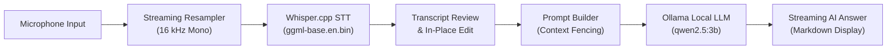

# Local AI Conversation Assistant (Windows Prototype)

[](https://www.typescriptlang.org/)
[](https://www.electronjs.org/)
[](https://react.dev/)
[](https://vitejs.dev/)
[](https://github.com/ggml-org/whisper.cpp)
[](https://ollama.com)
[](https://microsoft.com)

A Windows desktop prototype inspired by **Parakeet AI**, built for a software engineering internship assignment. The application provides a desktop window with **Start** and **Stop** buttons to capture microphone audio, displays transcription locally using **Whisper.cpp**, allows the user to review/edit the transcript, and streams progressive AI suggested answers locally via **Ollama** (`qwen2.5:3b`).

> **Project Classification:** This repository is an **internship assignment prototype**, not a commercial or production-grade release. Speech-to-text and LLM inference run locally on the host machine without third-party cloud AI APIs.

---

## 📋 Assignment Requirements & Implementation Mapping

The prototype was developed to fulfill the following internship assignment brief:

> *"Build a small desktop prototype inspired by Parakeet AI that opens a desktop window with Start and Stop buttons, captures microphone audio and displays transcription, lets the user click Suggest Answer to generate an answer to the transcribed question, displays the AI answer progressively, and runs speech-to-text and the LLM locally. Manual model installation is acceptable. Keep it simple."*

| Requested Requirement | Implementation in Prototype | Key Source Files |
| :--- | :--- | :--- |
| **Desktop Window** | Electron 33 + React 18 + TypeScript + Vite desktop window with minimum dimension constraints (720x520), dark theme, and frameless window styling. | `electron/main.ts`, `src/App.tsx` |
| **Start & Stop Controls** | Interactive action bar buttons with state handling: `Start` activates recording; `Stop` halts capture, flushes pending audio, and releases microphone hardware. | `src/App.tsx`, `src/audio/audioRecorder.ts` |
| **Microphone Audio Capture** | Web Audio API capture via `AudioRecorder` with a custom windowed-sinc `StreamingResampler` downmixing hardware audio (44.1/48 kHz) to 16 kHz 16-bit mono PCM. | `src/audio/audioRecorder.ts`, `src/audio/resampler.ts` |
| **Live Transcription Display** | Progressive transcript accumulation panel. Segmented audio chunks are transcribed sequentially via local Whisper.cpp and displayed in real time. | `src/App.tsx`, `src/audio/transcriptionQueue.ts` |
| **Transcript Review & Editing** | In-place transcript edit toggle (`Edit` / `Done`) allowing the user to review, correct phonetic misrecognitions, or refine punctuation before querying the LLM. | `src/App.tsx` |
| **Suggest Answer Action** | Contextually enabled `Suggest Answer` button that feeds the active (or edited) transcript into the local LLM prompt builder. | `src/App.tsx`, `electron/promptBuilder.ts` |
| **Progressive / Streaming AI Answer** | Real-time token streaming from local Ollama (`POST /api/chat`) via Electron IPC WebContents events, rendered live with cancellation support. | `electron/ollamaService.ts`, `src/App.tsx` |
| **Local Speech-to-Text** | Whisper.cpp CLI (`whisper-cli.exe`) running the `ggml-base.en.bin` model on the local CPU without cloud speech APIs. | `electron/whisperService.ts`, `electron/whisperConfig.ts` |
| **Local LLM Inference** | Ollama background daemon serving `qwen2.5:3b` over local loopback (`http://127.0.0.1:11434`). Zero cloud inference APIs. | `electron/ollamaService.ts`, `electron/ollamaConfig.ts` |
| **Manual Model Installation** | Supported via conventional directory placement (`bin/`, `models/`, `ollama pull qwen2.5:3b`); Whisper runtime and model are pre-packaged in release builds. | `electron-builder.json`, `electron/whisperConfig.ts` |

---

## 🏗️ Architecture & Data Pipeline

The application processes speech and generates answers through a strict local sequential pipeline:

```
[ Microphone ]
      │ (Web Audio API: 44.1 / 48 kHz mono)
      ▼
[ StreamingResampler ] ──► 16 kHz 16-bit PCM WAV Chunks
      │
      ▼
[ SpeechSegmenter ] ────► Silence & Energy Gating (RMS threshold: 0.012)
      │
      ▼
[ TranscriptionQueue ] ─► Sequential FIFO Execution (Max concurrency = 1)
      │
      ▼
[ Whisper.cpp ] ────────► Local CPU STT (whisper-cli.exe + ggml-base.en.bin)
      │
      ▼
[ Transcript Review ] ──► Live Display & Optional In-Place User Editing
      │
      ▼
[ Prompt Builder ] ─────► Anti-Hallucination Framing & Context Boundary
      │
      ▼
[ Ollama Daemon ] ──────► Local LLM Inference (qwen2.5:3b via 127.0.0.1:11434)
      │
      ▼
[ Streaming Answer ] ───► Progressive Token-by-Token Markdown Display
```



---

## ⚙️ Local Execution & Prerequisite Clarification

To maintain transparency about how "local" execution is achieved:

1. **Speech-to-Text (Whisper.cpp):**
   - The native Whisper executable (`whisper-cli.exe` + companion DLLs) and the `ggml-base.en.bin` model (~147.4 MB) are **pre-bundled inside the application distribution** via `extraResources`.
   - In development mode, files reside in `./bin/` and `./models/`.
   - In packaged mode, paths resolve dynamically from `process.resourcesPath/bin` and `process.resourcesPath/models`.
   - Transcription runs entirely on your local CPU without network communication.

2. **Large Language Model (Ollama + `qwen2.5:3b`):**
   - Ollama is **not bundled inside the application installer**. Bundling a ~3.5 GB LLM daemon and weights directly into an installer creates severe packaging bloat and prevents users from managing GPU acceleration or model versions independently.
   - Ollama must be installed as a separate local service and kept running on `http://127.0.0.1:11434`.
   - The application automatically probes Ollama reachability on startup and presents an actionable in-app guide if Ollama is offline or if `qwen2.5:3b` has not yet been pulled.

> ⚠️ **Offline Operation Notice:** Once Ollama and `qwen2.5:3b` are installed locally, normal speech transcription and answer generation do not make outbound calls to external cloud AI services. However, the initial download of Ollama and model weights requires internet connectivity. True air-gapped machine execution has not been independently verified.

---

## 📦 Windows Distribution Formats (Phase 6)

The prototype provides two packaging formats for Windows 64-bit systems, built using `electron-builder`:

| Artifact Name | Distribution Format | File Size | Description |
| :--- | :---: | :---: | :--- |
| **`Local AI Conversation Assistant-Setup-0.1.0.exe`** | NSIS Installer | `~210.7 MB`<br>(`220,979,052` bytes) | Standard Windows installer wizard. Installs to `%LOCALAPPDATA%\Programs`, registers Desktop and Start Menu shortcuts, and includes an uninstaller. |
| **`Local AI Conversation Assistant-Portable-0.1.0.exe`** | Portable Executable | `~202.1 MB`<br>(`211,914,944` bytes) | Standalone single-file executable. Runs without installation by extracting temporarily to `%LOCALAPPDATA%\Temp`. Useful for testing without administrative rights. |
| **`release/win-unpacked/`** | Directory Target | `~348 MB`<br>(uncompressed) | Complete unpacked folder for direct inspection and headless smoke testing. |

> **Important:** Both formats package the Whisper.cpp STT engine and base model, but **both still require Ollama to be running on the host system** to serve LLM answer suggestions.

---

## 🚀 End-User Setup Guide (Windows)

### Hardware & Software Prerequisites
- **Operating System:** Windows 10 or Windows 11 (64-bit x64)
- **Processor:** Modern multi-core CPU (Intel Core i5/i7/i9 8th gen+ or AMD Ryzen 3000+)
- **System Memory:** Minimum 8 GB RAM (16 GB recommended for concurrent STT + LLM execution)
- **Disk Space:**
  - Application + Whisper STT: ~350 MB free space
  - Ollama runtime + `qwen2.5:3b` model: ~3.5 GB free space
- **Audio:** Built-in microphone, USB headset, or external microphone

### Step-by-Step Installation

1. **Install Ollama & Pull the Model:**
   - Download and run the official Windows installer from [https://ollama.com/download/OllamaSetup.exe](https://ollama.com/download/OllamaSetup.exe).
   - Once installed, open PowerShell or Command Prompt and download the `qwen2.5:3b` model:
     ```powershell
     ollama pull qwen2.5:3b
     ```
   - Verify that Ollama is running (check for the Ollama llama icon in your Windows notification tray).

2. **Launch the Assistant:**
   - Run `Local AI Conversation Assistant-Setup-0.1.0.exe` to install, or double-click `Local AI Conversation Assistant-Portable-0.1.0.exe` to run immediately.
   - *Note on SmartScreen:* Because this open-source prototype is not signed with a commercial EV certificate, Windows Defender SmartScreen may display an "Unknown publisher" prompt. Click **More info** -> **Run anyway**.

3. **Verify Status Indicators:**
   - **Whisper Badge:** Displays `Whisper: Ready` (uses pre-bundled local files).
   - **Ollama Badge:** Displays `Ollama: Ready (qwen2.5:3b)` if the daemon is running.
   - *If Ollama is offline:* An in-app warning card appears with instructions and a **"Re-check Ollama"** button.

4. **Operate the Prototype:**
   - Click **Start** and speak into your microphone.
   - Click **Stop** when done speaking. The transcript will appear in the **Conversation Transcript** panel.
   - *(Optional)* Click **Edit** to adjust any misrecognized technical terms or punctuation, then click **Done**.
   - Click **Suggest Answer** to stream a response progressively from Ollama.

---

## 🛠️ Developer Setup & Build Commands

### 1. Clone & Install
```powershell
git clone https://github.com/AbhiJeetSoni22/Local-AI-Conversation-Assistant.git
cd Local-AI-Conversation-Assistant
npm install
```

### 2. Run in Development Mode
```powershell
npm run dev
```

### 3. Production Build & Packaging
```powershell
# Compile TypeScript and build Vite bundles
npm run build

# Package both NSIS Installer and Portable executable
npm run dist

# Package NSIS Installer only
npm run dist:nsis

# Package Portable executable only
npm run dist:portable

# Package unpacked directory target only (win-unpacked)
npm run dist:dir

# Regenerate multi-resolution Windows app icons (.ico / .png)
npm run icons
```

---

## 🧪 Testing & Validation Summary

### 1. Automated Test Suites (262 Assertions, 0 Failures)

The codebase includes 8 automated test scripts that validate application components deterministically using synthetic audio buffers and mock servers:

| Command | Focus | Assertions | Result |
| :--- | :--- | :---: | :---: |
| `npm run validate:whisper` | Standalone Whisper execution on known sample (`samples/jfk.wav`) | 4 steps | ✅ Pass |
| `npm run test:whisper` | Whisper error handling, corrupted model, and WAV format checks | 18 tests | ✅ Pass |
| `npm run validate:ollama` | Live probe of local Ollama daemon and token streaming | 3 steps | ✅ Pass |
| `npm run test:ollama` | Ollama NDJSON parsing, prompt truncation, and cancellation | 36 tests | ✅ Pass |
| `npm run test:audio` | Audio resampling, downmixing, RMS detection, and queue bounds | 22 tests | ✅ Pass |
| `npm run test:accuracy` | Diagnostic hallucination filtering and vocabulary context | 46 tests | ✅ Pass |
| `npm run test:pipeline` | Signal processing, windowed-sinc resampler, and VAD segmenter | 98 tests | ✅ Pass |
| `npm run test:phase5` | Dynamic readiness checks, transcript edit invariance, and UI states | 42 tests | ✅ Pass |

### 2. Manual Windows Microphone Retesting & Known Limitations

Manual testing was performed on Windows hardware with real microphones:
- **What Works Well:** Short sentences, clear conversational phrasing, and standard speech transcribe promptly (~3-4s per utterance on standard CPUs).
- **Known Limitations & Inaccuracies:**
  - **Acoustic Similarity:** The embedded base model (`ggml-base.en.bin`, ~148 MB) can misrecognize phonetically similar phrases (e.g. *"fixed a few bugs"* was observed transcribing as *"filled a few books"*).
  - **Trailing Audio Sensitivity:** In environments with ambient room hiss or aggressive microphone auto-gain (AGC), trailing silence can occasionally sample non-speech tokens.
  - **Acoustic Trade-Off:** Smaller speech models offer fast local CPU inference but have lower phonetic accuracy than larger models (e.g. `medium.en` or `large-v3`).
  - **Mitigation:** The application deliberately provides an **in-place Transcript Edit mode**, allowing users to correct any misrecognized words before submitting the text to the LLM.

> **Honesty Notice:** We do **not** claim 100% speech recognition accuracy. Speech recognition depends heavily on microphone quality, background noise, speaker accent, and acoustic model size.

---

## 🔒 Security, Privacy & Data Handling

The security and privacy posture of this prototype reflects its local architecture:

- **Zero Third-Party Cloud AI APIs:** Speech-to-text (Whisper.cpp) and LLM inference (Ollama) execute locally on host CPU/GPU hardware. No audio recordings or transcripts are transmitted to OpenAI, Anthropic, or external cloud AI services.
- **Local Loopback Communication Only:** The only network communication initiated by the Electron main process consists of HTTP requests to `http://127.0.0.1:11434` to communicate with the locally running Ollama daemon.
- **Electron Process Hardening:**
  - `contextIsolation: true` is strictly enforced.
  - `nodeIntegration: false` prevents the renderer from accessing Node.js runtime APIs.
  - `sandbox: true` restricts renderer access to system resources.
  - Content Security Policy: `default-src 'self'; script-src 'self'; style-src 'self' 'unsafe-inline';`
- **Temporary File Hygiene:** Temporary audio chunks created during recording are written to `os.tmpdir()` and deleted immediately after transcription via `try ... finally` blocks.
- **Graceful Process Disposal:** Child processes (`whisper-cli.exe`) and active HTTP streams are tracked and terminated upon window close or application exit hooks (`before-quit`, `will-quit`).

---

## 📖 Technical Documentation Index

For detailed architectural and engineering documentation, refer to the [`docs/`](./docs) directory:

| Document | Purpose |
| :--- | :--- |
| **[Project Overview](./docs/PROJECT_OVERVIEW.md)** | Background, assignment context, core constraints, and system boundaries. |
| **[Project Roadmap](./docs/PROJECT_ROADMAP.md)** | Phase-by-phase implementation plan, milestones, and status history. |
| **[System Architecture](./docs/ARCHITECTURE.md)** | Process architecture, IPC bridge contracts, and Mermaid sequence diagrams. |
| **[Application Flow](./docs/APPLICATION_FLOW.md)** | End-to-end data lifecycle, state transitions, and audio processing pipeline. |
| **[Development Setup](./docs/DEVELOPMENT_SETUP.md)** | Machine setup guide, toolchain prerequisites, and manual binary placement. |
| **[Testing & Validation](./docs/TESTING_AND_VALIDATION.md)** | Automated test documentation, test suites, and diagnostic procedures. |
| **[Configuration Reference](./docs/CONFIGURATION.md)** | Environment variables, electron-builder settings, and tuning parameters. |
| **[Troubleshooting Guide](./docs/TROUBLESHOOTING.md)** | Diagnostic steps for Whisper paths, Ollama errors, and SmartScreen warnings. |
| **[Implementation Status](./docs/IMPLEMENTATION_STATUS.md)** | Detailed audit log, verified features, release artifacts, and technical debt. |
| **[Decisions & Constraints](./docs/DECISIONS_AND_CONSTRAINTS.md)** | Engineering principles, trade-offs, and technology rationale. |
| **[Changelog](./docs/CHANGELOG.md)** | Chronological record of features, stabilization passes, and release milestones. |
