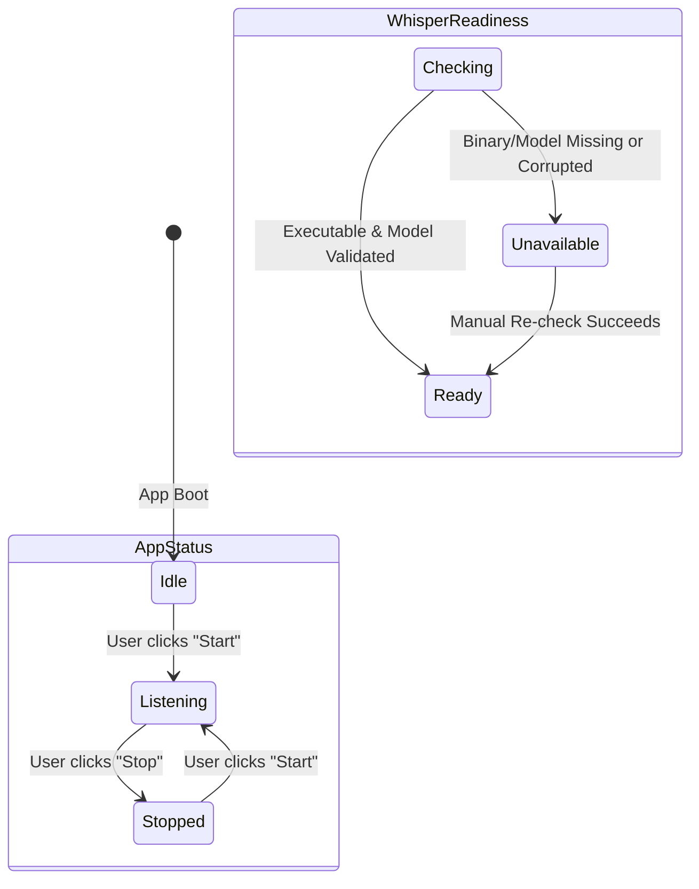
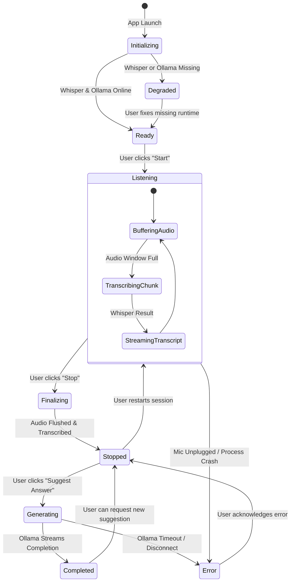

# Application Flow & State Machine

This document outlines the complete operational lifecycle of the **Local AI Conversation Assistant**, distinguishing between the **currently implemented behavior (Phase 1 & Phase 2)** and the **intended end-to-end workflow (Phases 3 through 5)**.

---

## 1. End-to-End Pipeline & Phase Mapping

The diagram below illustrates the full lifecycle from launch to answer generation, indicating which phase owns each stage:

```text
Application Launch
    ↓ [Phase 1 & 2: IMPLEMENTED]
Runtime & Model Readiness Check
    ↓ [Phase 2: IMPLEMENTED]
User Clicks "Start"
    ↓ [Phase 1: SCAFFOLD ONLY / Phase 4: PENDING]
Microphone Audio Capture (AudioWorklet)
    ↓ [Phase 4: PENDING]
Audio Resampling (16 kHz, 16-bit Mono PCM)
    ↓ [Phase 4: PENDING]
Audio Chunking & Silence Filtering
    ↓ [Phase 2: VALIDATOR READY / Phase 4: PIPELINE PENDING]
Local whisper.cpp Speech-to-Text
    ↓ [Phase 2: ENGINE READY / Phase 4 & 5: STREAMING PENDING]
Live Transcript Rolling Window
    ↓ [Phase 1: UI READY / Phase 5: ACCUMULATION PENDING]
User Clicks "Stop"
    ↓ [Phase 1: SCAFFOLD ONLY / Phase 4: FLUSH PENDING]
Final Audio Flush & Final Transcript Segment
    ↓ [Phase 1: SCAFFOLD ONLY / Phase 3: PENDING]
User Clicks "Suggest Answer"
    ↓ [Phase 3: PENDING]
Prompt Construction with Transcript Context
    ↓ [Phase 3: PENDING]
Local Ollama LLM Streaming (Qwen 2.5)
    ↓ [Phase 3: PENDING]
Progressive Token Streaming in Right Panel
    ↓ [Phase 3: PENDING]
Completed Suggested Answer
```

---

## 2. Actual Current State Model (Phase 1 & Phase 2)

Currently, the application tracks two independent states in `src/App.tsx`:

### 1. Application Execution State (`status`)
Controls the primary UI controls and button accessibility:
- **`Idle`**: Initial state upon application launch.
  - Buttons: `Start` is enabled; `Stop` is disabled; `Suggest Answer` is disabled.
  - Panels: Live Transcript shows empty-state prompt; Suggested Answer shows empty-state prompt.
- **`Listening`**: Entered when user clicks `Start`.
  - Buttons: `Start` is disabled; `Stop` is enabled; `Suggest Answer` is enabled.
  - Panels: Live Transcript displays active listening notice; Suggested Answer is enabled for placeholder demonstration.
- **`Stopped`**: Entered when user clicks `Stop`.
  - Buttons: `Start` is enabled; `Stop` is disabled; `Suggest Answer` is enabled.
  - Panels: Retains any current placeholder or transcript content.

### 2. Whisper Readiness State (`whisperStatus`)
Tracks local speech engine health independently from UI interactions:
- **`Checking`**: Default state while Electron main queries environment paths.
  - Header: Displays blue badge `"Whisper: Checking"`.
- **`Ready`**: Executable (`whisper-cli.exe` or `whisper-server.exe`) and model (`ggml-base.en.bin`) are verified.
  - Header: Displays green badge `"Whisper: Ready"`.
  - Footer: Displays active engine and model filename.
- **`Unavailable`**: Executable or model is missing or invalid.
  - Header: Displays red badge `"Whisper: Unavailable"`.
  - Panels: Live Transcript displays warning card with setup instructions.



---

## 3. Intended Complete State Model (Phases 3 through 5)

In future phases, the UI state model will transition from independent scaffold flags into a unified, robust state machine:



### Detailed State Descriptions for Future Implementation:

| State | Trigger | Sub-Processes Active | UI Behavior & Controls |
| :--- | :--- | :--- | :--- |
| **`Initializing`** | App launch | IPC queries for Whisper and Ollama | Shows loading spinners; action buttons disabled. |
| **`Ready`** | All local runtimes verified | Idle | `Start` enabled; `Stop` and `Suggest Answer` disabled. |
| **`Degraded`** | Missing model or Ollama offline | None | Disables unavailable features; shows actionable setup instructions. |
| **`Listening`** | User clicks `Start` | Microphone AudioWorklet, Audio Resampler, Whisper Service | `Start` disabled; `Stop` enabled; real-time audio waveform active. |
| **`Transcribing`** | Audio chunk boundary | `whisper-cli.exe` or server inference | Live transcript updates with newly recognized tokens. |
| **`Finalizing`** | User clicks `Stop` | AudioWorklet teardown, final buffer flush | `Stop` button enters loading state until last segment completes. |
| **`Stopped`** | Final flush complete | None | `Start` enabled; `Suggest Answer` enabled; transcript frozen. |
| **`Generating`** | User clicks `Suggest Answer` | Ollama streaming request | `Suggest Answer` disabled; progressive text stream renders in right panel. |
| **`Completed`** | Ollama finishes generation | None | Full answer displayed; copy / clear buttons enabled. |
| **`Error`** | Audio disconnect or crash | Process disposal / recovery | Displays non-blocking notification; returns to safe state (`Stopped`). |

---

## 4. Audio Processing & Data Flow (Phase 4 Intended Pipeline)

1. **Capture**: The renderer requests 1-channel mono audio via `getUserMedia()`.
2. **Resample**: An `AudioWorkletNode` processes PCM frames on the audio thread, downsampling browser audio (typically 44.1 kHz or 48 kHz) to 16,000 Hz.
3. **Chunking**: Samples are accumulated into a sliding buffer (e.g. 3.0s duration).
4. **Silence Check**: RMS amplitude is checked. Silent buffers are discarded before IPC transit.
5. **IPC Transmission**: Raw 16-bit PCM WAV buffers are transmitted to Electron main via `ipcRenderer.invoke('audio:chunk')`.
6. **Inference**: Electron main invokes `whisperService.transcribe(buffer)`.
7. **Stream Update**: Recognized text is returned via IPC and appended to the React transcript state.

---

## 5. Ollama Answer Generation Flow (Phase 3 Intended Pipeline)

1. **Context Assembly**: When the user clicks "Suggest Answer", the renderer aggregates the current transcript.
2. **IPC Dispatch**: Renderer calls `window.electronApi.suggestAnswer(transcript)`.
3. **Prompt Template**: Electron main formats the prompt:
   ```text
   System: You are an expert meeting assistant. Analyze the meeting transcript below and provide a concise, actionable answer or suggested response.
   Transcript: {transcript}
   ```
4. **Token Streaming**: Electron main initiates a streaming request to `http://127.0.0.1:11434/api/generate` with model `qwen2.5:1.5b`.
5. **Progressive Display**: Each incoming chunk is pushed to the renderer via `ipcRenderer.on('ollama:stream')`, updating the UI incrementally.

