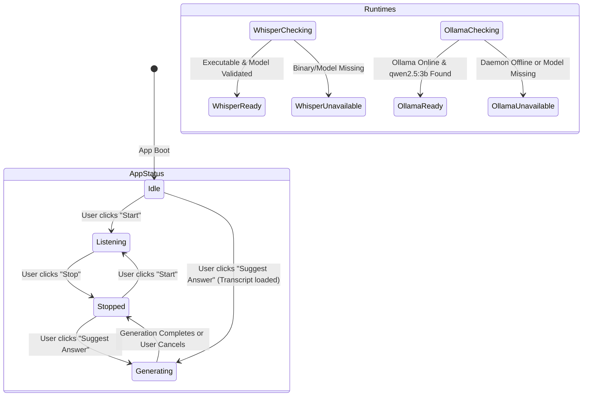
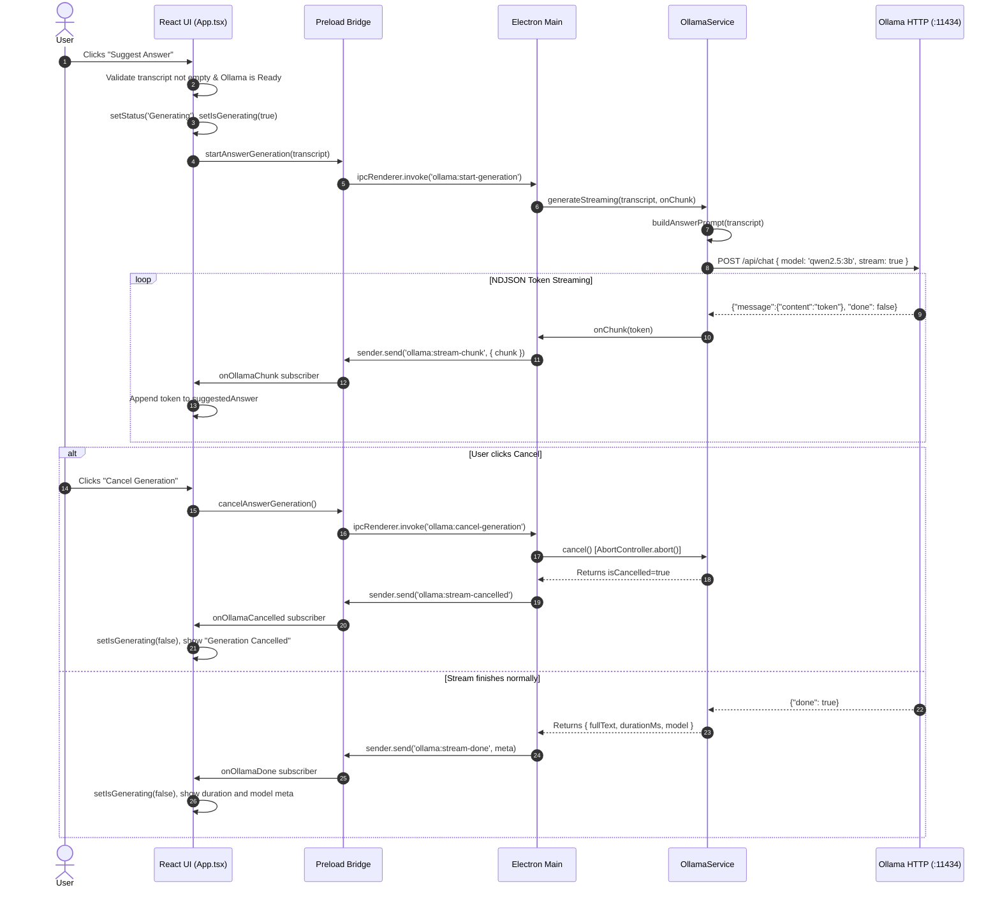
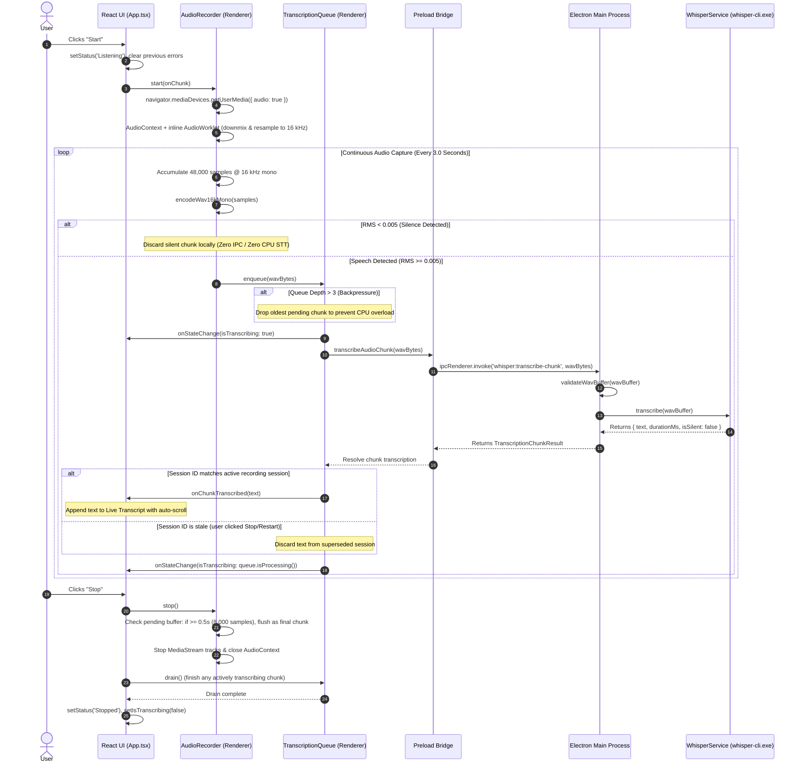

# Application Flow & State Machine

This document outlines the complete operational lifecycle of the **Local AI Conversation Assistant**, detailing the **implemented behavior (Phase 1 through Phase 4)** and the **intended prompt engineering and end-to-end polish (Phase 5)**.

---

## 1. End-to-End Pipeline & Phase Mapping

The diagram below illustrates the full lifecycle from launch to answer generation, indicating implementation status across phases:

```text
Application Launch
    ↓ [Phase 1, 2, 3 & 4: IMPLEMENTED]
Runtime & Model Readiness Check (Whisper + Ollama)
    ↓ [Phase 2 & 3: IMPLEMENTED]
User Clicks "Start"
    ↓ [Phase 4: IMPLEMENTED & TESTED]
Microphone Audio Capture (getUserMedia + AudioWorklet)
    ↓ [Phase 4: IMPLEMENTED & TESTED]
Audio Resampling (16 kHz, 16-bit Mono PCM)
    ↓ [Phase 4: IMPLEMENTED & TESTED]
Audio Chunking (3.0s window) & Client Silence Rejection (RMS < 0.005)
    ↓ [Phase 4: IMPLEMENTED & TESTED]
Sequential Transcription Queue & Backpressure Capping (Depth 3)
    ↓ [Phase 4: IMPLEMENTED & TESTED]
Typed IPC Transfer to Main Process (whisper:transcribe-chunk)
    ↓ [Phase 2 & 4: IMPLEMENTED & TESTED]
Local whisper.cpp Speech-to-Text Inference
    ↓ [Phase 4: IMPLEMENTED & TESTED]
Live Transcript Progressive Appending in Left Panel
    ↓ [Phase 4: IMPLEMENTED & TESTED]
User Clicks "Suggest Answer"
    ↓ [Phase 3: IMPLEMENTED & VERIFIED]
Prompt Construction with Strict Anti-Hallucination Framing
    ↓ [Phase 3: IMPLEMENTED & VERIFIED]
Local Ollama LLM Streaming (Qwen 2.5:3b)
    ↓ [Phase 3: IMPLEMENTED & VERIFIED]
Progressive Token Streaming in Right Panel (with Cancel Support)
    ↓ [Phase 3: IMPLEMENTED & VERIFIED]
Completed Suggested Answer & Metadata
```

---

## 2. Implemented State Model (Phase 1, 2, 3, & 4)

The application tracks four key state dimensions in `src/App.tsx`:

### 1. Application Execution State (`status` & `isTranscribing`)
Controls the primary UI controls and button accessibility:
- **`Idle`**: Initial state upon application launch.
  - Buttons: `Start` is enabled; `Stop` is disabled; `Suggest Answer` is disabled until transcript exists and Ollama is ready.
  - Panels: Live Transcript shows empty-state prompt with "Load Sample Meeting Transcript" utility; Suggested Answer shows empty-state prompt.
- **`Listening`**: Entered when user clicks `Start`.
  - Action: Microphone capture is active. Audio is sampled, resampled to 16 kHz mono, buffered into 3.0-second intervals, encoded into WAV, and queued for Whisper transcription.
  - Indicators: Shows emerald "Listening" status badge and animated audio equalizer wave. When Whisper is actively processing an audio chunk, a subtle "Transcribing audio..." spinner indicator activates.
  - Buttons: `Start` is disabled; `Stop` is enabled.
- **`Stopped`**: Entered when user clicks `Stop` or after generation finishes.
  - Action: Audio capture stops, remaining buffers >= 0.5s flush, media streams release, and in-flight queue items drain cleanly.
  - Buttons: `Start` is enabled; `Stop` is disabled.
- **`Generating`**: Entered when user clicks `Suggest Answer`.
  - Buttons: `Start`, `Stop`, and `Suggest Answer` are disabled; `Cancel Generation` button appears.
  - Panels: Suggested Answer displays purple streaming status badge, pulsing cursor, and progressively accumulating tokens.

### 2. Whisper Readiness State (`whisperStatus`)
Tracks local speech engine health:
- **`Checking`**: While Electron main queries environment paths.
- **`Ready`**: Executable (`whisper-cli.exe` or `whisper-server.exe`) and model (`ggml-base.en.bin`) are verified.
- **`Unavailable`**: Executable or model is missing or invalid. Actionable warning card is rendered.

### 3. Ollama Readiness State (`ollamaStatus`)
Tracks local LLM daemon and model availability:
- **`Checking`**: While Electron main queries `http://127.0.0.1:11434/api/version` and `/api/tags`.
- **`Ready`**: Ollama daemon is reachable and target model (`qwen2.5:3b`) is verified.
- **`Unavailable`**: Ollama daemon is offline or model is not pulled. An actionable warning card guides the user to install Ollama and run `ollama pull qwen2.5:3b`.



---

## 3. Streaming Suggest Answer Flow (Phase 3 Implemented Pipeline)



---

## 4. Live Audio Capture & Speech-to-Text Pipeline (Phase 4 Implemented Flow)

The Phase 4 audio pipeline enables local, real-time microphone capture and progressive transcription:



### Detailed Lifecycle Steps:
1. **Microphone Acquisition**: The renderer calls `navigator.mediaDevices.getUserMedia` with constraint flags: mono channel (`channelCount: 1`), browser acoustic echo cancellation (`echoCancellation: true`), background noise suppression (`noiseSuppression: true`), and automatic gain control (`autoGainControl: true`).
2. **AudioWorklet Processing**: Samples are captured on the high-priority Web Audio rendering thread via an inline `AudioWorkletNode`. If the hardware sample rate is not 16,000 Hz (typically 48,000 Hz or 44,100 Hz), the samples are resampled to exactly 16 kHz using linear interpolation.
3. **Window Buffering**: The recorder accumulates samples until a 3.0-second chunk window is reached (`48,000` samples at 16 kHz).
4. **Silence Gating**: Each chunk is evaluated for Root-Mean-Square (RMS) amplitude. Buffers with RMS < 0.005 (e.g. ambient background room silence) are immediately discarded without invoking IPC or launching `whisper-cli.exe`.
5. **WAV Serialization**: Samples are converted from IEEE Float32 to 16-bit signed integer linear PCM (`pcm_s16le`) and wrapped in a canonical 44-byte RIFF/WAVE header.
6. **Sequential Execution & Backpressure**: `TranscriptionQueue` ensures only one chunk is sent to Whisper at any given time. If transcription latency causes queue depth to exceed 3 pending chunks, older chunks are safely dropped to prevent latency drift and memory buildup.
7. **Clean Session Teardown**: Clicking "Stop" releases hardware mic tracks, closes the `AudioContext`, flushes any remaining speech buffer exceeding 0.5s (`8,000` samples), and drains active in-flight requests. Stale chunks from previous recording sessions are invalidated by a monotonically incremented `sessionId`.
