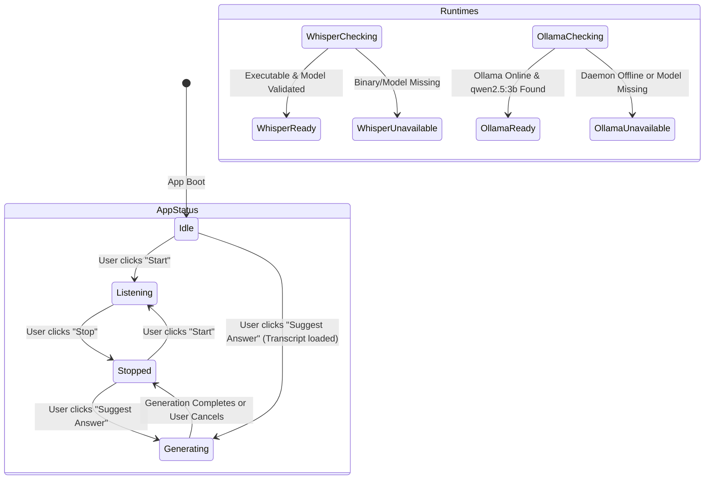
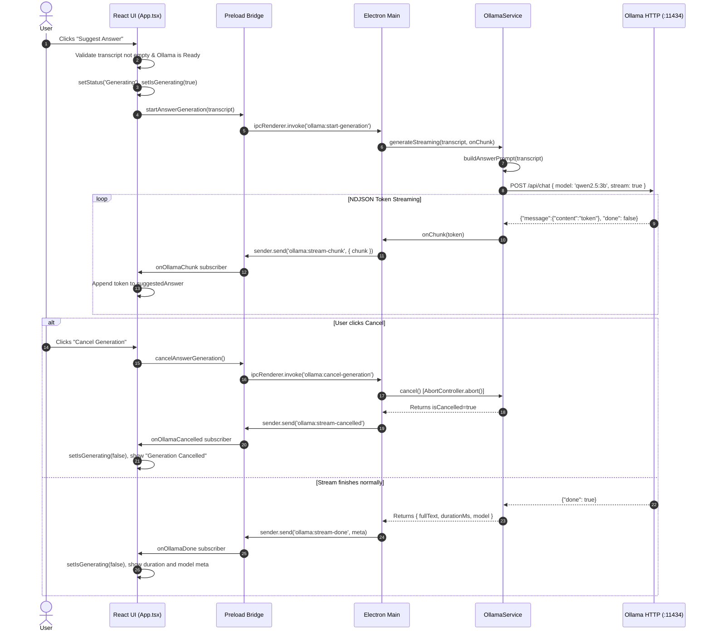

# Application Flow & State Machine

This document outlines the complete operational lifecycle of the **Local AI Conversation Assistant**, detailing the **implemented behavior (Phase 1, Phase 2, & Phase 3)** and the **intended audio streaming pipeline (Phases 4 through 5)**.

---

## 1. End-to-End Pipeline & Phase Mapping

The diagram below illustrates the full lifecycle from launch to answer generation, indicating implementation status across phases:

```text
Application Launch
    ↓ [Phase 1, 2 & 3: IMPLEMENTED]
Runtime & Model Readiness Check (Whisper + Ollama)
    ↓ [Phase 2 & 3: IMPLEMENTED]
User Clicks "Start"
    ↓ [Phase 1: SCAFFOLD ONLY / Phase 4: PENDING]
Microphone Audio Capture (AudioWorklet)
    ↓ [Phase 4: PENDING]
Audio Resampling (16 kHz, 16-bit Mono PCM)
    ↓ [Phase 4: PENDING]
Audio Chunking & Silence Filtering
    ↓ [Phase 2: VALIDATOR READY / Phase 4: PIPELINE PENDING]
Local whisper.cpp Speech-to-Text
    ↓ [Phase 2: ENGINE READY / Phase 4: STREAMING PENDING]
Live Transcript Rolling Window
    ↓ [Phase 1: UI READY / Phase 3: SAMPLE LOAD / Phase 4: LIVE MIC]
User Clicks "Suggest Answer"
    ↓ [Phase 3: IMPLEMENTED & VERIFIED]
Prompt Construction with Strict Anti-Hallucination Framing
    ↓ [Phase 3: IMPLEMENTED & VERIFIED]
Local Ollama LLM Streaming (Qwen 2.5:3b)
    ↓ [Phase 3: IMPLEMENTED & VERIFIED]
Progressive Token Streaming in Right Panel (with Cancel Support)
    ↓ [Phase 3: IMPLEMENTED & VERIFIED]
Completed Suggested Answer & Metadata
```

---

## 2. Implemented State Model (Phase 1, 2, & 3)

The application tracks four key state dimensions in `src/App.tsx`:

### 1. Application Execution State (`status`)
Controls the primary UI controls and button accessibility:
- **`Idle`**: Initial state upon application launch.
  - Buttons: `Start` is enabled; `Stop` is disabled; `Suggest Answer` is disabled until transcript exists and Ollama is ready.
  - Panels: Live Transcript shows empty-state prompt with "Load Sample Meeting Transcript"; Suggested Answer shows empty-state prompt.
- **`Listening`**: Entered when user clicks `Start` (scaffold state in Phase 3).
  - Buttons: `Start` is disabled; `Stop` is enabled.
- **`Stopped`**: Entered when user clicks `Stop` or after generation finishes.
  - Buttons: `Start` is enabled; `Stop` is disabled.
- **`Generating`**: Entered when user clicks `Suggest Answer`.
  - Buttons: `Start`, `Stop`, and `Suggest Answer` are disabled; `Cancel Generation` button appears.
  - Panels: Suggested Answer displays purple streaming status badge, pulsing cursor, and progressively accumulating tokens.

### 2. Whisper Readiness State (`whisperStatus`)
Tracks local speech engine health:
- **`Checking`**: While Electron main queries environment paths.
- **`Ready`**: Executable (`whisper-cli.exe` or `whisper-server.exe`) and model (`ggml-base.en.bin`) are verified.
- **`Unavailable`**: Executable or model is missing or invalid. Actionable warning card is rendered.

### 3. Ollama Readiness State (`ollamaStatus`)
Tracks local LLM daemon and model availability:
- **`Checking`**: While Electron main queries `http://127.0.0.1:11434/api/version` and `/api/tags`.
- **`Ready`**: Ollama daemon is reachable and target model (`qwen2.5:3b`) is verified.
- **`Unavailable`**: Ollama daemon is offline or model is not pulled. An actionable warning card guides the user to install Ollama and run `ollama pull qwen2.5:3b`.



---

## 3. Streaming Suggest Answer Flow (Phase 3 Implemented Pipeline)



---

## 4. Audio Processing & Data Flow (Phase 4 Intended Pipeline)

1. **Capture**: The renderer requests 1-channel mono audio via `getUserMedia()`.
2. **Resample**: An `AudioWorkletNode` processes PCM frames on the audio thread, downsampling browser audio (typically 44.1 kHz or 48 kHz) to 16,000 Hz.
3. **Chunking**: Samples are accumulated into a sliding buffer (e.g. 3.0s duration).
4. **Silence Check**: RMS amplitude is checked. Silent buffers are discarded before IPC transit.
5. **IPC Transmission**: Raw 16-bit PCM WAV buffers are transmitted to Electron main via `ipcRenderer.invoke('audio:chunk')`.
6. **Inference**: Electron main invokes `whisperService.transcribe(buffer)`.
7. **Stream Update**: Recognized text is returned via IPC and appended to the React transcript state.
