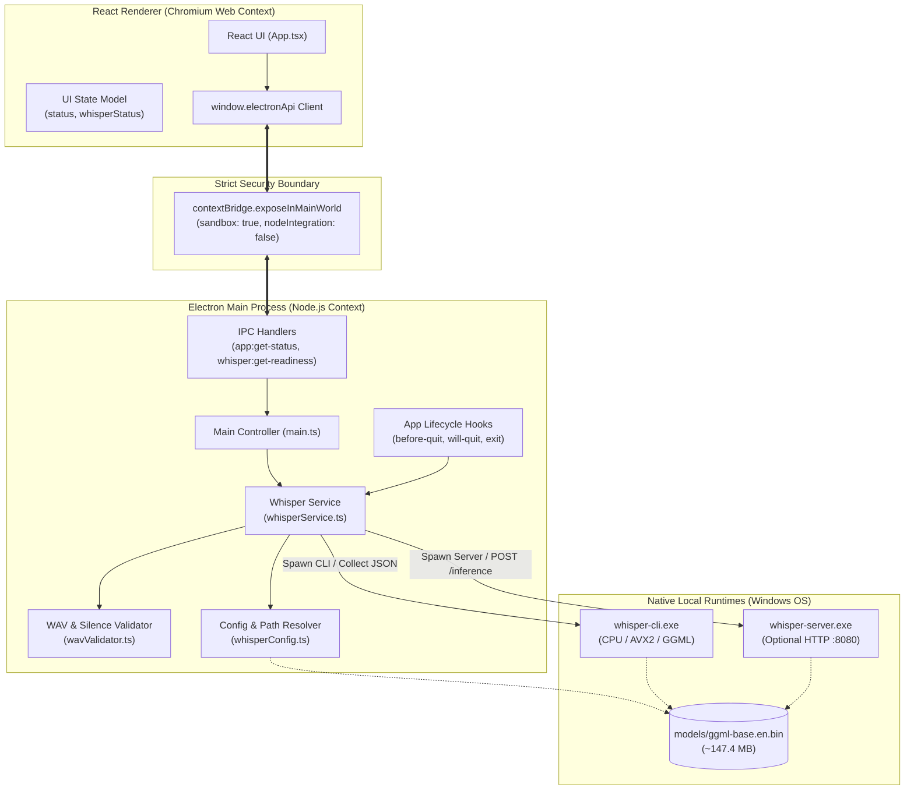
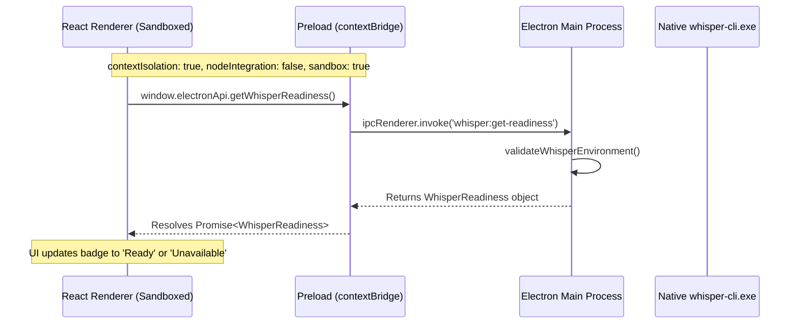
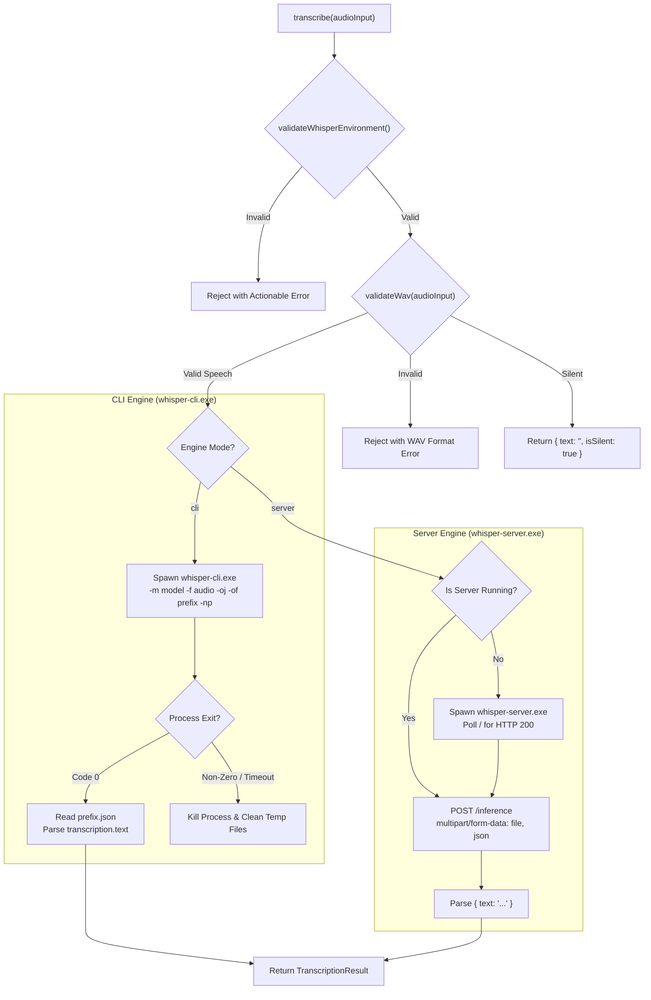
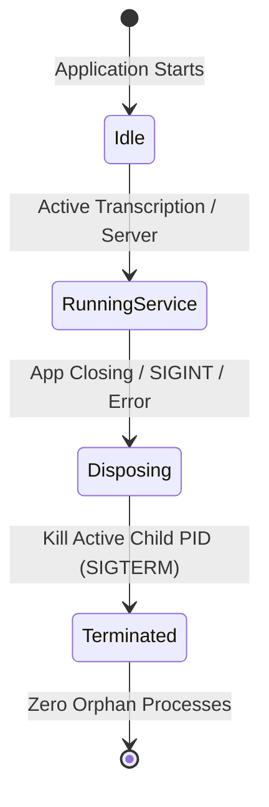

# System Architecture: Local AI Conversation Assistant

This document details the architectural design, security boundaries, component responsibilities, and data flow of the **Local AI Conversation Assistant**, matching the code implemented in Phase 1 and Phase 2.

---

## 1. High-Level Architecture Overview

The system adheres strictly to a **process-isolated, local-first architecture**. All heavy computation (speech-to-text inference and future LLM reasoning) occurs in dedicated native child processes or daemons managed exclusively by the Electron Main Process.



---

## 2. Process Separation & Security Boundary

Electron security defaults are strictly enforced to protect local system resources and guarantee privacy:



### Security Enforcement Rules:
1. **`contextIsolation: true`**: The renderer code cannot access the preload script's prototype or internals.
2. **`nodeIntegration: false`**: The renderer has zero direct access to Node.js `fs`, `child_process`, `os`, or `path`.
3. **`sandbox: true`**: Renderer processes run in a Chromium-level OS sandbox.
4. **Typed Preload Exclusivity**: Only pre-approved, strictly typed functions are bridged through `contextBridge`. The renderer cannot invoke arbitrary IPC channels or spawn processes.
5. **No Filesystem / Executable Leaks**: The renderer receives high-level readiness statuses and strings; it never handles raw file descriptors or executes system commands.

---

## 3. Component Breakdown & Responsibilities

### A. Electron Main Process (`electron/`)
The Main Process acts as the central orchestrator and privileged environment:
- **Application Lifecycle (`main.ts`)**: Creates the `BrowserWindow`, sets minimum dimensions (720x520), removes native window menu bars for a modern desktop look, and listens for shutdown events.
- **Child Process Management**: Tracks spawned child processes (PID tracking) and guarantees cleanup when the user closes the application or on crash signals.
- **Resource Cleanup**: Subscribes to `app.on('before-quit')`, `app.on('will-quit')`, and `app.on('window-all-closed')` to ensure no orphaned processes linger in Windows Task Manager.
- **IPC Handlers**:
  - `app:get-status`: Returns application version, platform, and basic health.
  - `whisper:get-readiness`: Executes non-destructive environment validation and returns status.
  - `whisper:validate`: Triggers re-check of executable and model paths.

### B. Preload Script (`electron/preload.ts`)
The Preload script defines the explicit API contract exposed to `window.electronApi`:
```typescript
const electronApi = {
  getStatus: () => ipcRenderer.invoke('app:get-status'),
  getWhisperReadiness: () => ipcRenderer.invoke('whisper:get-readiness'),
  validateWhisper: () => ipcRenderer.invoke('whisper:validate'),
  platform: process.platform,
}
```
No Node modules or raw event emitters are exposed to `window`.

### C. React Renderer Process (`src/`)
The renderer represents the client presentation layer:
- **`src/App.tsx`**: Main UI component containing the responsive grid layout, status indicators, action buttons, and panels.
- **UI State Model**: Maintains UI status (`Idle`, `Listening`, `Stopped`) and Whisper readiness (`Checking`, `Ready`, `Unavailable`).
- **User Actions**:
  - `Start`: Transitions UI status to `Listening` (scaffold state).
  - `Stop`: Transitions UI status to `Stopped` (scaffold state).
  - `Suggest Answer`: Demonstrates placeholder card (Ollama integration scheduled for Phase 3).
  - `Clear Answer`: Resets placeholder state.
- **Actionable Error Rendering**: When Whisper is unavailable, displays a highlighted guidance card instructing the user where to place missing binaries or models.

---

## 4. Whisper Foundation Architecture

The local speech-to-text integration foundation is separated into three decoupled modules:

### 1. Configuration & Path Resolution (`electron/whisperConfig.ts`)
- Resolves paths relative to project root (`process.env.APP_ROOT` or `process.cwd()`).
- Default paths:
  - CLI Binary: `./bin/whisper-cli.exe`
  - Server Binary: `./bin/whisper-server.exe`
  - Model: `./models/ggml-base.en.bin`
- Supports Windows environment variable overrides: `WHISPER_BIN_PATH`, `WHISPER_MODEL_PATH`, `WHISPER_ENGINE`, `WHISPER_PORT`.
- **Validation Rules**:
  - Executable must exist, be a regular file, and have a file size > 0 bytes.
  - Model file must exist, be a regular file, and exceed 10 MB (guards against empty files or truncated downloads).

### 2. Audio & WAV Validation (`electron/wavValidator.ts`)
Before any audio is sent to whisper.cpp, it is inspected at the byte level:
- Container Header: Verifies 4-byte `RIFF` and `WAVE` ASCII magic identifiers.
- Format Subchunk (`fmt `):
  - Validates audio format code `1` (Linear PCM). Rejects compressed or floating point formats.
  - Channels: 1 (mono) or 2 (stereo).
  - Bits per sample: exactly 16-bit.
  - Sample rate: checks for 16,000 Hz.
- Data Subchunk (`data`):
  - Confirms non-zero byte length.
  - Checks duration against a safety limit (default 120s max).
- **Silence & Energy Detection**:
  - Computes Root Mean Square (RMS) energy across 16-bit PCM frames.
  - If RMS < 0.005, the audio is flagged as `isSilent: true`. This allows the Whisper service to return empty text immediately without wasting CPU cycles running inference on silence.

### 3. Whisper Service (`electron/whisperService.ts`)
Manages execution across two distinct engine modes:



#### Engine Trade-offs:
- **`whisper-cli` (Default)**:
  - *Pros:* Atomic execution, zero port collisions, leaves no background servers running when idle, isolated memory usage.
  - *Cons:* Incurs ~600ms model-load overhead per execution.
- **`whisper-server` (Optional)**:
  - *Pros:* Keeps model loaded in RAM/VRAM; transcription starts immediately.
  - *Cons:* Consistently consumes ~200MB background memory; requires port management (`127.0.0.1:8080`) and startup readiness polling.

---

## 5. Process Lifecycle & Process Cleanup

To prevent orphaned `whisper-cli.exe` or `whisper-server.exe` processes on Windows:



1. **Active Child Reference**: `activeCliProcess` and `serverProcess` hold active `ChildProcess` instances.
2. **Termination Handlers**: `WhisperService.dispose()` calls `kill('SIGTERM')` on any active child process and unlinks temporary files.
3. **Application Exit Hooks**:
   - `app.on('before-quit', () => whisperService.dispose())`
   - `app.on('will-quit', () => whisperService.dispose())`
   - `process.once('exit', () => whisperService.dispose())`
   - `process.once('SIGINT', () => whisperService.dispose())`
   - `process.once('SIGTERM', () => whisperService.dispose())`

