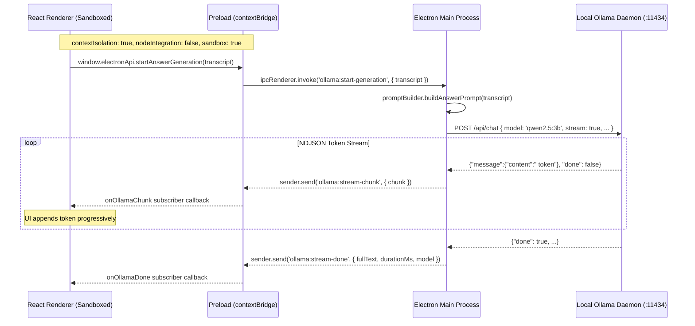
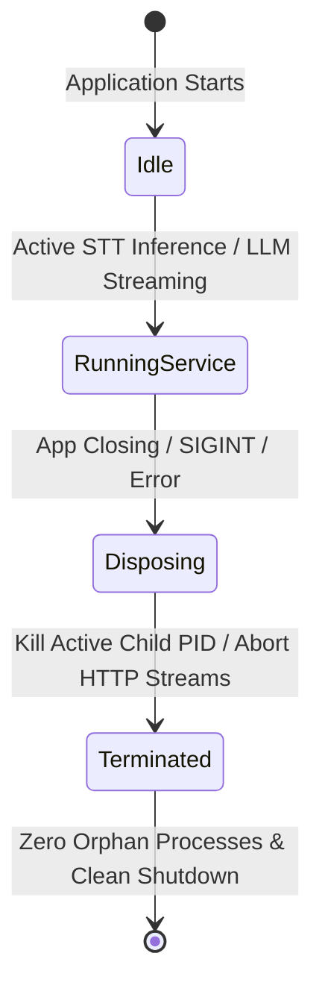
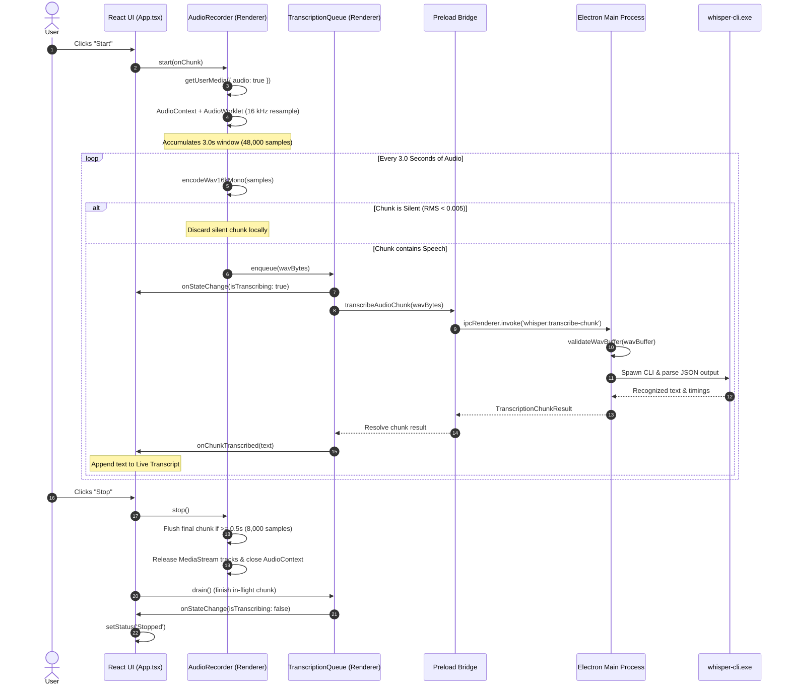

# System Architecture: Local AI Conversation Assistant

This document details the architectural design, security boundaries, component responsibilities, and data flow of the **Local AI Conversation Assistant**, matching the implementation of Phase 1, Phase 2, Phase 3, and Phase 4.

---

## 1. High-Level Architecture Overview

The system adheres strictly to a **process-isolated, local-first architecture**. All heavy computation (speech-to-text inference and local LLM reasoning) occurs in dedicated native child processes or local daemons managed exclusively by the Electron Main Process. Audio capture, resampling, and WAV encoding occur on the client side in the React renderer via the Web Audio API.


---

## 2. Process Separation & Security Boundary

Electron security defaults are strictly enforced to protect local system resources and guarantee user privacy:



### Security Enforcement Rules:
1. **`contextIsolation: true`**: The renderer code cannot access the preload script's prototype or internals.
2. **`nodeIntegration: false`**: The renderer has zero direct access to Node.js `fs`, `child_process`, `os`, `http`, or `path`.
3. **`sandbox: true`**: Renderer processes run in a Chromium-level OS sandbox.
4. **Typed Preload Exclusivity**: Only pre-approved, strictly typed functions and event listeners are bridged through `contextBridge`. The renderer cannot invoke arbitrary IPC channels, access network sockets, or spawn processes.
5. **No Filesystem / Executable Leaks**: The renderer receives high-level readiness statuses and strings; it never handles raw file descriptors or executes system commands.

---

## 3. Component Breakdown & Responsibilities

### A. Electron Main Process (`electron/`)
The Main Process acts as the central orchestrator and privileged environment:
- **Application Lifecycle (`main.ts`)**: Creates the `BrowserWindow`, sets minimum dimensions (720x520), removes native window menu bars for a modern desktop look, and listens for shutdown events.
- **Process Management & Cleanup**: Tracks spawned child processes and guarantees cleanup when the user closes the application or on crash signals.
- **IPC Handlers**:
  - `app:get-status`: Returns application version, platform, and basic health.
  - `whisper:get-readiness`: Executes non-destructive Whisper environment validation.
  - `whisper:validate`: Re-checks executable and model paths.
  - `whisper:transcribe-chunk`: Validates incoming PCM WAV chunk via `validateWavBuffer` and passes to `WhisperService.transcribe()`.
  - `ollama:get-readiness`: Checks Ollama daemon health (`/api/version`) and verifies target model (`/api/tags`).
  - `ollama:start-generation`: Sanitizes transcript, initiates streaming HTTP request to Ollama, and broadcasts tokens to renderer via WebContents.
  - `ollama:cancel-generation`: Aborts active HTTP stream via `AbortController`.

### B. Preload Script (`electron/preload.ts`)
The Preload script defines the explicit API contract exposed to `window.electronApi`:
```typescript
const electronApi = {
  // App Status
  getStatus: () => ipcRenderer.invoke('app:get-status'),
  platform: process.platform,

  // Whisper (Phase 2 & 4)
  getWhisperReadiness: () => ipcRenderer.invoke('whisper:get-readiness'),
  validateWhisper: () => ipcRenderer.invoke('whisper:validate'),
  transcribeAudioChunk: (wavBytes: Uint8Array) =>
    ipcRenderer.invoke('whisper:transcribe-chunk', wavBytes),

  // Ollama (Phase 3)
  getOllamaReadiness: () => ipcRenderer.invoke('ollama:get-readiness'),
  startAnswerGeneration: (transcript: string) =>
    ipcRenderer.invoke('ollama:start-generation', { transcript }),
  cancelAnswerGeneration: () =>
    ipcRenderer.invoke('ollama:cancel-generation'),

  // Streaming Event Listeners (return unsubscribe functions)
  onOllamaChunk: (callback: (data: { chunk: string }) => void) => () => void,
  onOllamaDone: (callback: (data: { fullText: string; durationMs: number; model: string }) => void) => () => void,
  onOllamaError: (callback: (data: { error: string }) => void) => () => void,
  onOllamaCancelled: (callback: () => void) => () => void,
}
```

### C. React Renderer Process (`src/`)
The renderer represents the client presentation layer:
- **`src/App.tsx`**: Main UI component containing the responsive grid layout, status indicators, action buttons, and panels.
- **UI State Model**: Maintains execution status (`Idle`, `Listening`, `Stopped`, `Generating`), transcribing status (`isTranscribing`), component readiness (`Checking`, `Ready`, `Unavailable`), conversation transcript, and streaming answer state.
- **User Actions**:
  - `Start`: Requests microphone permissions, initializes `AudioRecorder`, and begins continuous 3-second audio chunking and live transcription.
  - `Stop`: Halts audio capture, releases microphone hardware tracks, drains in-flight audio transcription queue, and transitions UI to `Stopped`.
  - `Suggest Answer`: Validates transcript and Ollama readiness, then triggers local streaming answer generation.
  - `Cancel Generation`: Aborts active Ollama inference stream mid-flight.
  - `Load Sample Meeting Transcript`: Populates transcript with conversation text for immediate testing.
  - `Clear Transcript` / `Clear Answer`: Resets state.
- **Actionable Error Rendering**: When Whisper, Ollama, or Microphone access is unavailable, displays a highlighted guidance card instructing the user on exact manual setup steps.

### D. Audio Capture & Processing Pipeline (`src/audio/`)
- **`audioRecorder.ts`**: Handles microphone acquisition via `navigator.mediaDevices.getUserMedia({ audio: { channelCount: 1, echoCancellation: true, noiseSuppression: true, autoGainControl: true } })`. Employs an `AudioWorkletNode` (loaded dynamically via inline Blob URL) with fallback to `ScriptProcessorNode`. Accumulates samples in 3.0-second intervals (48,000 samples @ 16 kHz), and automatically flushes pending buffers >= 0.5s on stop.
- **`resampler.ts`**: Pure DSP utilities for multi-channel downmixing (`downmixToMono`), linear interpolation with anti-aliasing low-pass filtering (`resampleTo16k`), and Root-Mean-Square energy calculation (`calculateRms`).
- **`wavEncoder.ts`**: Encodes 16 kHz Float32 PCM arrays into standard 44-byte header 16-bit linear PCM (`pcm_s16le`) RIFF/WAVE buffers (`Uint8Array`). Evaluates RMS energy against silence threshold (`0.005`) to discard silent chunks before IPC transmission.
- **`transcriptionQueue.ts`**: Strict FIFO sequential worker queue that prevents concurrent `whisper-cli.exe` invocations. Implements session ID validation (drops stale chunks from previous recordings) and queue depth backpressure capping (`maxQueueDepth = 3`) to prevent memory pressure when Whisper transcription duration exceeds audio window duration.

---

## 4. Ollama LLM Service Architecture (`electron/ollamaService.ts`)

The local LLM integration provides zero-cloud, streaming text generation:

### 1. Configuration & Health Probing (`electron/ollamaConfig.ts`)
- **Default host:** `http://127.0.0.1:11434` (overridable via `OLLAMA_HOST` or `OLLAMA_BASE_URL`).
- **Default model:** `qwen2.5:3b` (overridable via `OLLAMA_MODEL`).
- **Two-phase probe:**
  1. `GET /api/version` (3-second timeout): Verifies daemon is running and reachable.
  2. `GET /api/tags` (4-second timeout): Confirms target model is downloaded and ready.

### 2. Prompt Builder & Anti-Hallucination Guard (`electron/promptBuilder.ts`)
- Treats conversation transcripts as untrusted context.
- Bounds input length to 12,000 characters (truncates older conversation while preserving recent tail).
- Demarcates input with strict delimiters (`--- BEGIN TRANSCRIPT ---` / `--- END TRANSCRIPT ---`).
- Enforces strict system instructions: base response exclusively on the transcript, acknowledge incomplete context politely, and avoid fabricated facts.

### 3. Streaming Chat Engine & Cancellation (`electron/ollamaService.ts`)
- Communicates with Ollama's native endpoint: `POST /api/chat` with `{ stream: true }`.
- Parses incoming `application/x-ndjson` token chunks as they arrive from the readable stream.
- Emits chunks progressively to renderer via Electron WebContents.
- **Concurrency Guard:** Rejects concurrent generation requests with a descriptive error.
- **AbortController Cancellation:** Immediately aborts the HTTP request when the user clicks "Cancel" or closes the window.

---

## 5. Process Lifecycle & Process Cleanup

To prevent orphaned processes or dangling network sockets on Windows:



1. **Active Child Reference**: `activeCliProcess` and `serverProcess` hold active `ChildProcess` instances.
2. **Active Stream Reference**: `activeAbortController` holds active `AbortController` instances.
3. **Termination Handlers**: `WhisperService.dispose()` kills child processes; `OllamaService.dispose()` aborts active streams.
4. **Application Exit Hooks**:
   - `app.on('before-quit', () => { ollamaService.dispose(); whisperService.dispose(); })`
   - `app.on('will-quit', () => { ollamaService.dispose(); whisperService.dispose(); })`
   - `app.on('window-all-closed', () => { ollamaService.dispose(); whisperService.dispose(); })`
   - `process.once('exit', () => { ... })`
   - `process.once('SIGINT', () => { ... })`
   - `process.once('SIGTERM', () => { ... })`

---

## 6. Live Audio Capture & Speech-to-Text Architecture (Phase 4)

The Phase 4 audio pipeline enables local, real-time speech recognition from the user's microphone:



### Audio Architecture Highlights:
1. **Inline AudioWorklet**: AudioWorklet processor code is packaged into an inline `Blob` URL so it loads consistently across both development Vite HMR and packaged `file://` protocols, with graceful degradation to `ScriptProcessorNode` if unsupported.
2. **Client-Side Silence Rejection**: Evaluating RMS energy in `wavEncoder.ts` prior to IPC invocation prevents spawning native processes when the user is not speaking, drastically cutting CPU overhead.
3. **Non-Overlapping Chunks**: Audio chunks are partitioned into distinct 3.0-second non-overlapping windows to avoid duplicate words in the live transcript.
4. **Sequential Processing & Backpressure**: `TranscriptionQueue` processes one chunk at a time, enforcing an absolute ceiling (`maxQueueDepth = 3`). If Whisper inference takes longer than real-time on lower-power CPUs, older pending chunks are safely dropped to prevent latency accumulation and memory growth.
5. **Session Isolation**: Each recording cycle is assigned a unique `sessionId`. When the user clicks "Stop" and "Start" again, all queued chunks from superseded sessions are rejected immediately without executing Whisper.
