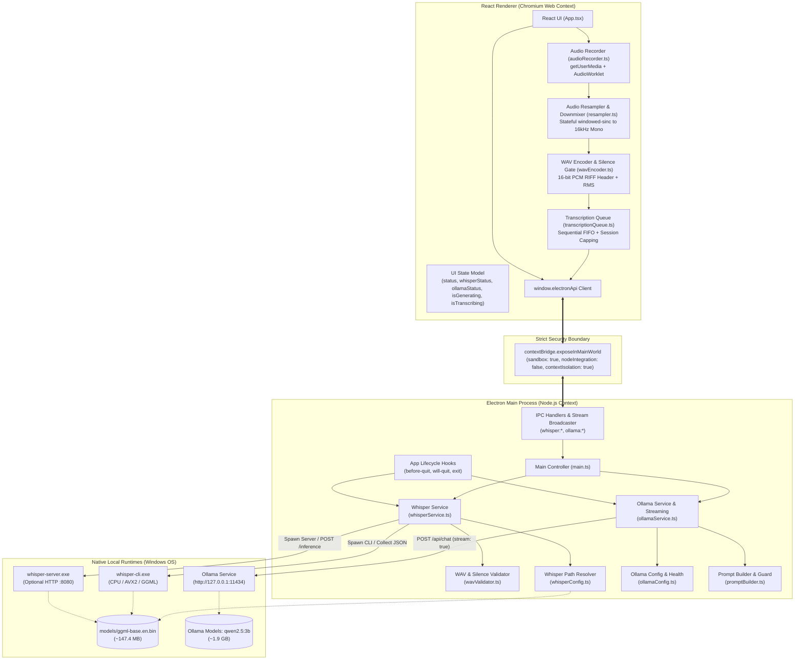
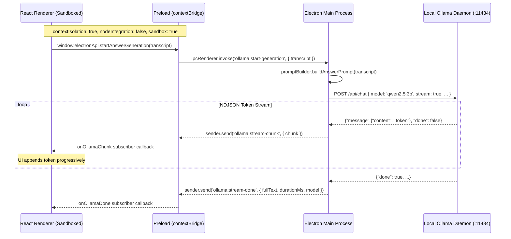
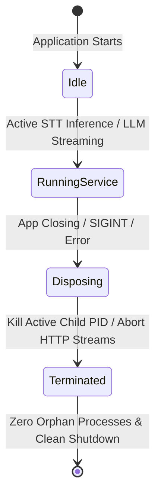
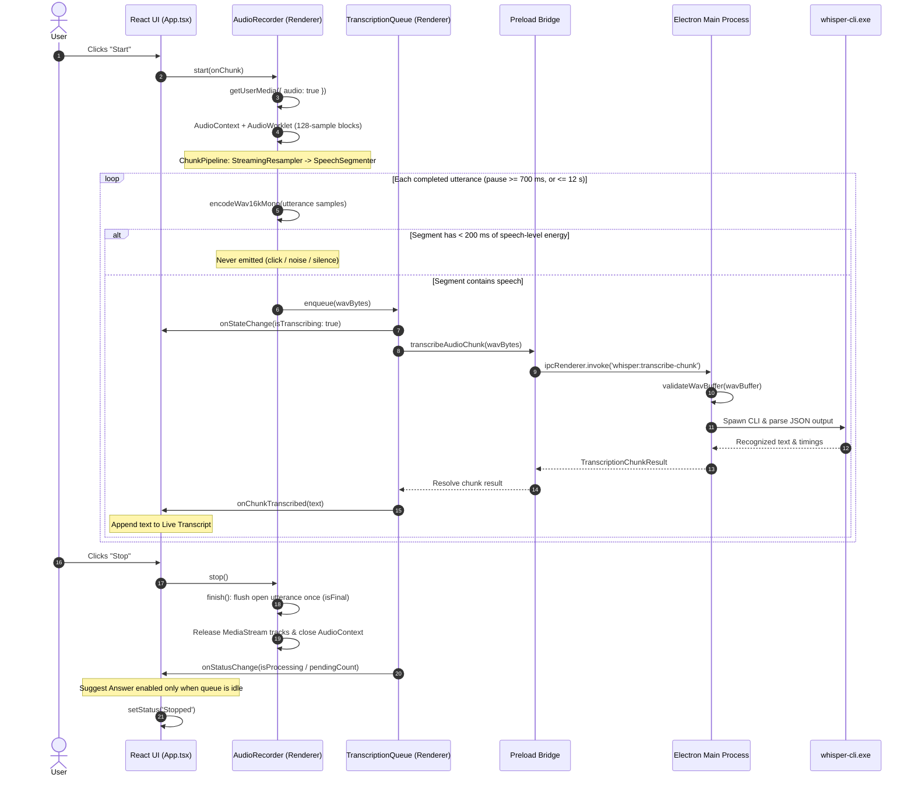

# System Architecture: Local AI Conversation Assistant

This document details the architectural design, security boundaries, component responsibilities, and data flow of the **Local AI Conversation Assistant**, matching the implementation of Phase 1, Phase 2, Phase 3, and Phase 4.

---

## 1. High-Level Architecture Overview

The system adheres strictly to a **process-isolated, local-first architecture**. All heavy computation (speech-to-text inference and local LLM reasoning) occurs in dedicated native child processes or local daemons managed exclusively by the Electron Main Process. Audio capture, resampling, and WAV encoding occur on the client side in the React renderer via the Web Audio API.



---

## 2. Process Separation & Security Boundary

Electron security defaults are strictly enforced to protect local system resources and guarantee user privacy:



### Security Enforcement Rules:
1. **`contextIsolation: true`**: The renderer code cannot access the preload script's prototype or internals.
2. **`nodeIntegration: false`**: The renderer has zero direct access to Node.js `fs`, `child_process`, `os`, `http`, or `path`.
3. **`sandbox: true`**: Renderer processes run in a Chromium-level OS sandbox.
4. **Typed Preload Exclusivity**: Only pre-approved, strictly typed functions and event listeners are bridged through `contextBridge`. The renderer cannot invoke arbitrary IPC channels, access network sockets, or spawn processes.
5. **No Filesystem / Executable Leaks**: The renderer receives high-level readiness statuses and strings; it never handles raw file descriptors or executes system commands.

---

## 3. Component Breakdown & Responsibilities

### A. Electron Main Process (`electron/`)
The Main Process acts as the central orchestrator and privileged environment:
- **Application Lifecycle (`main.ts`)**: Creates the `BrowserWindow`, sets minimum dimensions (720x520), removes native window menu bars for a modern desktop look, and listens for shutdown events.
- **Process Management & Cleanup**: Tracks spawned child processes and guarantees cleanup when the user closes the application or on crash signals.
- **IPC Handlers**:
  - `app:get-status`: Returns application version, platform, and basic health.
  - `whisper:get-readiness`: Executes non-destructive Whisper environment validation.
  - `whisper:validate`: Re-checks executable and model paths.
  - `whisper:transcribe-chunk`: Validates incoming PCM WAV chunk via `validateWavBuffer` and passes to `WhisperService.transcribe()`.
  - `ollama:get-readiness`: Checks Ollama daemon health (`/api/version`) and verifies target model (`/api/tags`).
  - `ollama:start-generation`: Sanitizes transcript, initiates streaming HTTP request to Ollama, and broadcasts tokens to renderer via WebContents.
  - `ollama:cancel-generation`: Aborts active HTTP stream via `AbortController`.

### B. Preload Script (`electron/preload.ts`)
The Preload script defines the explicit API contract exposed to `window.electronApi`:
```typescript
const electronApi = {
  // App Status
  getStatus: () => ipcRenderer.invoke('app:get-status'),
  platform: process.platform,

  // Whisper (Phase 2 & 4)
  getWhisperReadiness: () => ipcRenderer.invoke('whisper:get-readiness'),
  validateWhisper: () => ipcRenderer.invoke('whisper:validate'),
  transcribeAudioChunk: (wavBytes: Uint8Array) =>
    ipcRenderer.invoke('whisper:transcribe-chunk', wavBytes),

  // Ollama (Phase 3)
  getOllamaReadiness: () => ipcRenderer.invoke('ollama:get-readiness'),
  startAnswerGeneration: (transcript: string) =>
    ipcRenderer.invoke('ollama:start-generation', { transcript }),
  cancelAnswerGeneration: () =>
    ipcRenderer.invoke('ollama:cancel-generation'),

  // Streaming Event Listeners (return unsubscribe functions)
  onOllamaChunk: (callback: (data: { chunk: string }) => void) => () => void,
  onOllamaDone: (callback: (data: { fullText: string; durationMs: number; model: string }) => void) => () => void,
  onOllamaError: (callback: (data: { error: string }) => void) => () => void,
  onOllamaCancelled: (callback: () => void) => () => void,
}
```

### C. React Renderer Process (`src/`)
The renderer represents the client presentation layer:
- **`src/App.tsx`**: Main UI component containing the responsive grid layout, status indicators, action buttons, and panels.
- **UI State Model**: Maintains execution status (`Idle`, `Listening`, `Stopped`, `Generating`), transcribing status (`isTranscribing`), component readiness (`Checking`, `Ready`, `Unavailable`), conversation transcript, and streaming answer state.
- **User Actions**:
  - `Start`: Requests microphone permissions, initializes `AudioRecorder`, and begins pause-aligned utterance segmentation and live transcription.
  - `Stop`: Halts audio capture, releases microphone hardware tracks, flushes the final utterance exactly once, and transitions UI to `Stopped`. The **Suggest Answer** button stays disabled until the transcription queue has finished the last audio (`transcriptionBusy`), so an answer is never generated from a truncated transcript.
  - `Suggest Answer`: Validates transcript and Ollama readiness, then triggers local streaming answer generation.
  - `Cancel Generation`: Aborts active Ollama inference stream mid-flight.
  - `Load Sample Meeting Transcript`: Populates transcript with conversation text for immediate testing.
  - `Clear Transcript` / `Clear Answer`: Resets state.
- **Actionable Error Rendering**: When Whisper, Ollama, or Microphone access is unavailable, displays a highlighted guidance card instructing the user on exact manual setup steps.

### D. Audio Capture & Processing Pipeline (`src/audio/`)
- **`audioRecorder.ts`**: Browser plumbing only: `getUserMedia({ audio: { channelCount: 1, echoCancellation, noiseSuppression, autoGainControl } })` (all three default to `true`, overridable via `audioConstraints` for A/B tests), `AudioWorkletNode` via inline Blob URL with `ScriptProcessorNode` fallback, Start/Stop lifecycle. Delegates every signal-processing step to `ChunkPipeline`. `stop()` is idempotent, so Stop + device-unplug cannot submit the final chunk twice. Records numeric capture facts (`getDiagnostics()`: AudioContext rate and the DSP flags the browser actually applied).
- **`chunkPipeline.ts`**: Pure, unit-tested pipeline: raw device-rate blocks -> `StreamingResampler` -> `SpeechSegmenter` (default `speech` mode) or the legacy fixed 3.0 s chunker (`fixed` mode) -> 16-bit WAV -> `AudioChunkPayload` (`sessionId`, monotonically increasing `chunkIndex`, `isFinal`). `finish()` returns the final chunk once; later calls return `[]`.
- **`resampler.ts`**: `StreamingResampler` (stateful, windowed-sinc, integer-rational output positions, unity DC gain, cutoff just below the 8 kHz target Nyquist). It carries fractional phase and filter history across the 128-sample AudioWorklet blocks. The previous implementation resampled each block independently, which (measured by `npm run analyze:resampler`) stretched the timeline by +0.78 % at 48 kHz / -0.95 % at 44.1 kHz, mis-pitched tones, and aliased content above 8 kHz into the speech band. `resampleTo16k()` (whole buffers only) now uses the same algorithm; `downmixToMono`, `calculateRms` unchanged.
- **`speechSegmenter.ts`**: Energy-based boundary finder (20 ms frames, adaptive noise floor, speech threshold `max(0.010, 3 x floor)`). A segment starts at speech onset with 300 ms pre-roll, ends after 700 ms of non-speech (trailing pad 250 ms), is split at the quietest point in the last second if it reaches 12 s (soft split on a 250 ms pause after 8 s), and is discarded if it contains < 200 ms of speech-level energy (clicks, bumps, breath). It is **not** a speech recogniser: it only gates and finds boundaries. Thresholds are options and must be validated on a real microphone.
- **`wavEncoder.ts`**: Encodes 16 kHz Float32 PCM into a 44-byte-header 16-bit PCM RIFF/WAVE `Uint8Array` and reports whole-chunk RMS; chunks below RMS `0.005` are flagged silent and never sent.
- **`transcriptionQueue.ts`**: Strict FIFO sequential worker (never two `whisper-cli.exe` at once). Session-ID validation drops stale chunks and stale in-flight results; **duplicate `(sessionId, chunkIndex)` submissions are ignored**; backpressure (`maxQueueDepth = 3`) drops the oldest non-final chunk, counts it (`getDroppedCount()`), and never drops the final chunk.
- **`transcriptAccumulator.ts`**: `SegmentGate` accepts a segment only if it belongs to the active session and its `chunkIndex` is strictly greater than the last accepted one; `appendSegmentText` joins with single spaces and never drops words. This replaces a text-based `endsWith()` check that silently erased genuinely repeated speech.
- **`electron/vocabularyConfig.ts`**: `cleanWhisperOutput(raw)` returns `{ raw, text, markersRemoved, loopTrimmed }`. (1) `filterWhisperMarkers` removes only non-speech annotations: any short `[bracketed]` span, parenthesised sound descriptions (`(applause)`, `(whirring)`), and music notes. (2) `trimRepetitionLoops` trims a decoder loop (a word repeated >= 8 times, or a 2-4 word phrase repeated >= 5 times) to one occurrence; ordinary emphasis ("no no no no no") is untouched. The former regex list that deleted phrases such as "the channel is called ...", "thanks for watching" and a trailing "happy?" was **removed** because it deleted genuine speech. `raw` is retained for diagnostics only and is never sent to the renderer or logged by default. The optional technical-vocabulary prompt is OFF by default (opt in with `WHISPER_USE_VOCAB_PROMPT=1`, or `WHISPER_INITIAL_PROMPT`).
- **`electron/whisperConfig.ts`**: `buildWhisperCliArgs()` is the single source of the CLI argument vector: `-m <model> -f <wav> -oj -of <prefix> -t <threads> -np` plus `--prompt <text>` only when configured. No decoder flags (`-sns`, `-nf`, `-nth`, `-mc` ...) are passed; whisper.cpp defaults apply (temperature fallback on, no-speech threshold 0.6, entropy threshold 2.4, log-prob threshold -1.0).

## 4. Ollama LLM Service Architecture (`electron/ollamaService.ts`)

The local LLM integration provides zero-cloud, streaming text generation:

### 1. Configuration & Health Probing (`electron/ollamaConfig.ts`)
- **Default host:** `http://127.0.0.1:11434` (overridable via `OLLAMA_HOST` or `OLLAMA_BASE_URL`).
- **Default model:** `qwen2.5:3b` (overridable via `OLLAMA_MODEL`).
- **Two-phase probe:**
  1. `GET /api/version` (3-second timeout): Verifies daemon is running and reachable.
  2. `GET /api/tags` (4-second timeout): Confirms target model is downloaded and ready.

### 2. Prompt Builder & Anti-Hallucination Guard (`electron/promptBuilder.ts`)
- Treats conversation transcripts as untrusted context.
- Bounds input length to 12,000 characters (truncates older conversation while preserving recent tail).
- Demarcates input with strict delimiters (`--- BEGIN TRANSCRIPT ---` / `--- END TRANSCRIPT ---`).
- System prompt treats the transcript as imperfect speech recognition: infer the most plausible question, answer a reasonably clear question directly and concisely without repeating garbled fragments or asking needless follow-ups, state a corrected-term assumption briefly ("Assuming you mean LangChain, ..."), ask exactly one short clarifying question only when genuinely ambiguous, never fabricate facts. It contains no rule tailored to specific transcription artefacts, so it cannot mask transcription faults.

### 3. Streaming Chat Engine & Cancellation (`electron/ollamaService.ts`)
- Communicates with Ollama's native endpoint: `POST /api/chat` with `{ stream: true }`.
- Parses incoming `application/x-ndjson` token chunks as they arrive from the readable stream.
- Emits chunks progressively to renderer via Electron WebContents.
- **Concurrency Guard:** Rejects concurrent generation requests with a descriptive error.
- **AbortController Cancellation:** Immediately aborts the HTTP request when the user clicks "Cancel" or closes the window.

---

## 5. Process Lifecycle & Process Cleanup

To prevent orphaned processes or dangling network sockets on Windows:



1. **Active Child Reference**: `activeCliProcess` and `serverProcess` hold active `ChildProcess` instances.
2. **Active Stream Reference**: `activeAbortController` holds active `AbortController` instances.
3. **Termination Handlers**: `WhisperService.dispose()` kills child processes; `OllamaService.dispose()` aborts active streams.
4. **Application Exit Hooks**:
   - `app.on('before-quit', () => { ollamaService.dispose(); whisperService.dispose(); })`
   - `app.on('will-quit', () => { ollamaService.dispose(); whisperService.dispose(); })`
   - `app.on('window-all-closed', () => { ollamaService.dispose(); whisperService.dispose(); })`
   - `process.once('exit', () => { ... })`
   - `process.once('SIGINT', () => { ... })`
   - `process.once('SIGTERM', () => { ... })`

---

## 6. Live Audio Capture & Speech-to-Text Architecture (Phase 4)

The Phase 4 audio pipeline enables local, real-time speech recognition from the user's microphone:



### Audio Architecture Highlights:
1. **Inline AudioWorklet**: Worklet code is packaged into an inline `Blob` URL so it loads in Vite dev and packaged `file://` modes, with graceful fallback to `ScriptProcessorNode`.
2. **One stateful resampler per recording**: filter history and fractional output position persist across blocks (see `resampler.ts` above).
3. **Utterance segmentation instead of blind 3.0 s cuts**: cuts fall in pauses, so words are not split, and non-speech (room noise, breath, the click on "Stop", trailing silence) is not sent to Whisper, removing the main opportunity for it to invent filler. There is **no overlap** between segments, therefore no overlap-deduplication logic exists or is needed. `segmentation: 'fixed'` restores the old behaviour for A/B comparison.
4. **Sequential Processing & Backpressure**: one chunk at a time; ceiling `maxQueueDepth = 3`; drops are counted; final chunk protected.
5. **Session Isolation & identity-based de-duplication**: unique `sessionId` per recording; queue ignores duplicate `(session, chunk)`; `SegmentGate` ignores late/out-of-order/foreign-session results.
6. **Context never leaks between chunks**: each chunk is a separate `whisper-cli` process, and whisper.cpp's `no_context` default is true, so no decoded text is carried from one chunk to the next. Repetition inside a transcript therefore comes from the decoder within one chunk, not from earlier chunks (verified in whisper.cpp source `whisper_full_with_state`).
7. **Initial prompt (optional, off by default)**: `--prompt` is injected into the single decode window of *every* chunk. Treat it as an experiment to be measured (`npm run diagnose:whisper`), not a fix.
8. **Output cleaning with raw/clean separation**: see `vocabularyConfig.ts` above. Transcript text is never logged unless `DEBUG_AUDIO=1` **and** `DEBUG_WHISPER_TEXT=1`.
