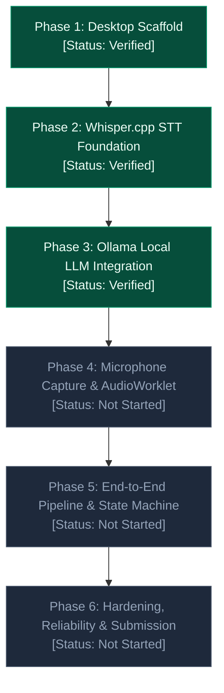

# Project Roadmap: Local AI Conversation Assistant

**Repository:** `AbhiJeetSoni22/Local-AI-Conversation-Assistant`  
**Current Milestone:** Phase 3 Complete  
**Final Submission Deadline:** November 4, 2026  
**Status Key:**  
- `Verified`: Code implemented, built, and validated against automated tests and criteria.  
- `Implemented — Not Verified`: Code exists but lacks complete verification.  
- `In Progress`: Currently undergoing development.  
- `Not Started`: Planned for a subsequent phase; no code written yet.  
- `Blocked`: Paused due to an external dependency or critical bug.  

---



---

## Phase 1 — Desktop Scaffold & Electron Security

- **Status:** `Verified`
- **Goal:** Establish a fast, secure, modern desktop foundation using Electron, React 18, TypeScript, and Vite.
- **Scope:**
  - Initialize Vite + Electron project with hot module replacement (HMR).
  - Enforce Electron process separation (`contextIsolation: true`, `nodeIntegration: false`, `sandbox: true`).
  - Implement two-panel layout: "Live Transcript" and "AI Suggested Answer".
  - Construct clean UI state machine for scaffold controls (`Start`, `Stop`, `Suggest Answer`).
- **Dependencies:** `electron`, `react`, `react-dom`, `vite`, `vite-plugin-electron`, `typescript`.
- **Primary Files:**
  - `electron/main.ts`
  - `electron/preload.ts`
  - `src/App.tsx`
  - `src/index.css`
  - `src/types/electron.d.ts`
  - `vite.config.ts`, `tsconfig.json`
- **Acceptance Criteria:**
  - Desktop window opens with native menu bar hidden.
  - Zero Node.js APIs exposed directly to renderer window.
  - IPC `app:get-status` returns platform and version cleanly.
  - Controls transition correctly between `Idle`, `Listening`, and `Stopped` without errors.
- **Validation Commands:**
  ```bash
  npm run build
  npm run dev
  ```

---

## Phase 2 — Whisper.cpp Local Speech-to-Text Foundation

- **Status:** `Verified`
- **Goal:** Establish and validate local speech recognition using `whisper.cpp` without cloud dependencies or audio streaming.
- **Scope:**
  - Determine and verify official prebuilt Windows x64 binaries (`whisper-cli.exe`, `whisper-server.exe`) and English model (`ggml-base.en.bin`).
  - Create project-level path resolution and environment variable overrides (`electron/whisperConfig.ts`).
  - Build strict PCM WAV validator and RMS silence detector (`electron/wavValidator.ts`).
  - Implement typed main process service with child process lifecycle management (`electron/whisperService.ts`).
  - Build standalone CLI validation script (`scripts/validate-whisper.ts`).
  - Build comprehensive 18-point failure mode test suite (`scripts/test-whisper-failures.ts`).
  - Surface Whisper readiness (`Checking`, `Ready`, `Unavailable`) in UI without connecting fake audio.
  - Update `.gitignore` to keep binary, model, and audio files out of Git.
- **Dependencies:** Prebuilt `whisper.cpp v1.9.2`, model `ggml-base.en.bin`, devDependency `tsx`.
- **Primary Files:**
  - `electron/whisperConfig.ts`
  - `electron/wavValidator.ts`
  - `electron/whisperService.ts`
  - `electron/main.ts`, `electron/preload.ts`
  - `src/App.tsx`, `src/types/electron.d.ts`, `src/index.css`
  - `scripts/validate-whisper.ts`, `scripts/test-whisper-failures.ts`
  - `.gitignore`, `README.md`
- **Acceptance Criteria:**
  - Standalone script transcribes sample JFK WAV offline and outputs text in < 5 seconds.
  - All 18 negative and reliability tests pass (missing binary, missing model, corrupt WAV, silence, port conflicts, cleanup).
  - Child processes killed automatically on app exit (zero orphan processes).
  - UI shows `Ready` if files exist, or `Unavailable` with clear instructions if missing.
- **Validation Commands:**
  ```bash
  npx tsc --noEmit
  npm run build
  npm run validate:whisper
  npm run test:whisper
  ```

---

## Phase 3 — Ollama Local LLM & Streaming Answer Generation

- **Status:** `Verified`
- **Goal:** Connect the desktop application to a local Ollama instance for fast, streaming AI conversational suggestions.
- **Scope:**
  - Define Ollama client configuration (default URL `http://127.0.0.1:11434`, model `qwen2.5:3b`).
  - Implement main process Ollama service with health check (`/api/version` and `/api/tags`).
  - Implement streaming response generation via Ollama's `POST /api/chat` with `{ stream: true }`.
  - Stream tokens from main process to renderer via typed IPC events (`ollama:stream-chunk`, `ollama:stream-done`, `ollama:stream-error`, `ollama:stream-cancelled`).
  - Enforce anti-hallucination framing and input length bounds (`electron/promptBuilder.ts`).
  - Support user-triggered cancellation via `AbortController`.
  - Enforce concurrency protection against simultaneous inference calls.
  - Build standalone Ollama validation script (`scripts/validate-ollama.ts`).
  - Build deterministic 36-point test suite (`scripts/test-ollama.ts`) with mock HTTP server.
  - Update "AI Suggested Answer" panel to display progressive streaming text, pulsing cursor, and duration metadata.
  - Add actionable UI warning card when Ollama daemon is offline or model is missing.
- **Dependencies:** Local `Ollama` installed on Windows; `qwen2.5:3b` pulled locally.
- **Primary Files:**
  - `electron/ollamaConfig.ts`
  - `electron/promptBuilder.ts`
  - `electron/ollamaService.ts`
  - `electron/main.ts`, `electron/preload.ts`
  - `src/App.tsx`, `src/types/electron.d.ts`, `src/index.css`
  - `scripts/validate-ollama.ts`, `scripts/test-ollama.ts`
- **Acceptance Criteria:**
  - Health check detects whether Ollama is reachable and model is available.
  - Suggest Answer button triggers streaming answer from Ollama using transcript context.
  - Renderer renders tokens progressively without freezing the UI.
  - All 36 automated unit & integration tests pass with 0 failures.
  - UI displays actionable error message with exact setup steps if Ollama is not ready.
- **Validation Commands:**
  ```bash
  npx tsc --noEmit
  npm run build
  npm run test:ollama
  npm run validate:ollama
  ```

---

## Phase 4 — Microphone Audio Capture & Audio Processing

- **Status:** `Not Started`
- **Goal:** Capture live microphone input in the renderer, resample to 16 kHz 16-bit PCM, and stream audio chunks to main process.
- **Scope:**
  - Request browser microphone permissions cleanly via `navigator.mediaDevices.getUserMedia`.
  - Implement `AudioWorklet` to capture raw audio samples on the audio thread.
  - Downsample incoming audio (e.g. 44.1/48 kHz) to 16,000 Hz single-channel mono PCM.
  - Implement audio chunker (3-to-5 second sliding audio windows or Voice Activity Detection).
  - Send audio chunk buffers across typed IPC to Electron main.
  - Electron main receives chunks, validates format with `wavValidator`, and feeds to `whisperService`.
  - Handle audio device disconnection, microphone denial, and background tab suspension.
- **Dependencies:** Web Audio API, `AudioWorkletNode`.
- **Expected Files:**
  - `src/audio/audioRecorder.ts`
  - `src/audio/pcmWorklet.ts` (or worklet processor)
  - `src/audio/wavEncoder.ts`
  - `electron/audioIpc.ts`
- **Acceptance Criteria:**
  - Clicking "Start" initiates microphone recording and updates badge to `Listening`.
  - Microphone audio is converted to valid 16 kHz 16-bit PCM buffers.
  - Chunks stream into Whisper service without UI lag or memory leaks.
  - Clicking "Stop" halts capture, flushes pending buffer, and transitions to `Stopped`.

---

## Phase 5 — End-to-End Pipeline & Application State Handling

- **Status:** `Not Started`
- **Goal:** Unify microphone capture, live whisper transcription, transcript accumulation, and Ollama answer suggestion into a seamless reactive workflow.
- **Scope:**
  - Implement central conversation manager in main/renderer coordinating states:
    `Idle` ➔ `Listening` ➔ `Transcribing` ➔ `Stopped` ➔ `Generating` ➔ `Completed`.
  - Append live transcribed segments into a rolling transcript window with auto-scrolling.
  - Deduplicate overlapping phrases from sliding audio windows.
  - Inject accumulated conversation context into Ollama prompt template.
  - Implement full reset / "Clear Conversation" functionality.
  - Ensure backpressure: if Whisper is busy transcribing, queue or drop non-speech chunks rather than overloading memory.
- **Expected Files:**
  - `src/context/ConversationContext.tsx`
  - `src/hooks/useConversation.ts`
  - Updates to `src/App.tsx`, `electron/main.ts`

---

## Phase 6 — Hardening, Air-Gapped Verification & Final Submission

- **Status:** `Not Started`
- **Goal:** Verify reliability on a clean Windows machine, package for distribution, and assemble submission artifacts.
- **Target Deadline:** November 4, 2026.
