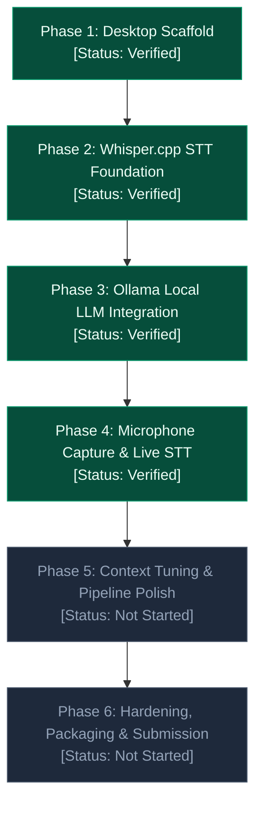

# Project Roadmap: Local AI Conversation Assistant

**Repository:** `AbhiJeetSoni22/Local-AI-Conversation-Assistant`  
**Current Milestone:** Phase 4 Complete  
**Final Submission Deadline:** November 4, 2026  
**Status Key:**  
- `Verified`: Code implemented, built, and validated against automated tests and criteria.  
- `Implemented — Not Verified`: Code exists but lacks complete verification.  
- `In Progress`: Currently undergoing development.  
- `Not Started`: Planned for a subsequent phase; no code written yet.  
- `Blocked`: Paused due to an external dependency or critical bug.  

---



---

## Phase 1 — Desktop Scaffold & Electron Security

- **Status:** `Verified`
- **Goal:** Establish a fast, secure, modern desktop foundation using Electron, React 18, TypeScript, and Vite.
- **Scope:**
  - Initialize Vite + Electron project with hot module replacement (HMR).
  - Enforce Electron process separation (`contextIsolation: true`, `nodeIntegration: false`, `sandbox: true`).
  - Implement two-panel layout: "Live Transcript" and "AI Suggested Answer".
  - Construct clean UI state machine for scaffold controls (`Start`, `Stop`, `Suggest Answer`).
- **Dependencies:** `electron`, `react`, `react-dom`, `vite`, `vite-plugin-electron`, `typescript`.
- **Primary Files:**
  - `electron/main.ts`
  - `electron/preload.ts`
  - `src/App.tsx`
  - `src/index.css`
  - `src/types/electron.d.ts`
  - `vite.config.ts`, `tsconfig.json`
- **Acceptance Criteria:**
  - Desktop window opens with native menu bar hidden.
  - Zero Node.js APIs exposed directly to renderer window.
  - IPC `app:get-status` returns platform and version cleanly.
  - Controls transition correctly between `Idle`, `Listening`, and `Stopped` without errors.
- **Validation Commands:**
  ```bash
  npm run build
  npm run dev
  ```

---

## Phase 2 — Whisper.cpp Local Speech-to-Text Foundation

- **Status:** `Verified`
- **Goal:** Establish and validate local speech recognition using `whisper.cpp` without cloud dependencies or audio streaming.
- **Scope:**
  - Determine and verify official prebuilt Windows x64 binaries (`whisper-cli.exe`, `whisper-server.exe`) and English model (`ggml-base.en.bin`).
  - Create project-level path resolution and environment variable overrides (`electron/whisperConfig.ts`).
  - Build strict PCM WAV validator and RMS silence detector (`electron/wavValidator.ts`).
  - Implement typed main process service with child process lifecycle management (`electron/whisperService.ts`).
  - Build standalone CLI validation script (`scripts/validate-whisper.ts`).
  - Build comprehensive 18-point failure mode test suite (`scripts/test-whisper-failures.ts`).
  - Surface Whisper readiness (`Checking`, `Ready`, `Unavailable`) in UI without connecting fake audio.
  - Update `.gitignore` to keep binary, model, and audio files out of Git.
- **Dependencies:** Prebuilt `whisper.cpp v1.9.2`, model `ggml-base.en.bin`, devDependency `tsx`.
- **Primary Files:**
  - `electron/whisperConfig.ts`
  - `electron/wavValidator.ts`
  - `electron/whisperService.ts`
  - `electron/main.ts`, `electron/preload.ts`
  - `src/App.tsx`, `src/types/electron.d.ts`, `src/index.css`
  - `scripts/validate-whisper.ts`, `scripts/test-whisper-failures.ts`
  - `.gitignore`, `README.md`
- **Acceptance Criteria:**
  - Standalone script transcribes sample JFK WAV offline and outputs text in < 5 seconds.
  - All 18 negative and reliability tests pass (missing binary, missing model, corrupt WAV, silence, port conflicts, cleanup).
  - Child processes killed automatically on app exit (zero orphan processes).
  - UI shows `Ready` if files exist, or `Unavailable` with clear instructions if missing.
- **Validation Commands:**
  ```bash
  npx tsc --noEmit
  npm run build
  npm run validate:whisper
  npm run test:whisper
  ```

---

## Phase 3 — Ollama Local LLM & Streaming Answer Generation

- **Status:** `Verified`
- **Goal:** Connect the desktop application to a local Ollama instance for fast, streaming AI conversational suggestions.
- **Scope:**
  - Define Ollama client configuration (default URL `http://127.0.0.1:11434`, model `qwen2.5:3b`).
  - Implement main process Ollama service with health check (`/api/version` and `/api/tags`).
  - Implement streaming response generation via Ollama's `POST /api/chat` with `{ stream: true }`.
  - Stream tokens from main process to renderer via typed IPC events (`ollama:stream-chunk`, `ollama:stream-done`, `ollama:stream-error`, `ollama:stream-cancelled`).
  - Enforce anti-hallucination framing and input length bounds (`electron/promptBuilder.ts`).
  - Support user-triggered cancellation via `AbortController`.
  - Enforce concurrency protection against simultaneous inference calls.
  - Build standalone Ollama validation script (`scripts/validate-ollama.ts`).
  - Build deterministic 36-point test suite (`scripts/test-ollama.ts`) with mock HTTP server.
  - Update "AI Suggested Answer" panel to display progressive streaming text, pulsing cursor, and duration metadata.
  - Add actionable UI warning card when Ollama daemon is offline or model is missing.
- **Dependencies:** Local `Ollama` installed on Windows; `qwen2.5:3b` pulled locally.
- **Primary Files:**
  - `electron/ollamaConfig.ts`
  - `electron/promptBuilder.ts`
  - `electron/ollamaService.ts`
  - `electron/main.ts`, `electron/preload.ts`
  - `src/App.tsx`, `src/types/electron.d.ts`, `src/index.css`
  - `scripts/validate-ollama.ts`, `scripts/test-ollama.ts`
- **Acceptance Criteria:**
  - Health check detects whether Ollama is reachable and model is available.
  - Suggest Answer button triggers streaming answer from Ollama using transcript context.
  - Renderer renders tokens progressively without freezing the UI.
  - All 36 automated unit & integration tests pass with 0 failures.
  - UI displays actionable error message with exact setup steps if Ollama is not ready.
- **Validation Commands:**
  ```bash
  npx tsc --noEmit
  npm run build
  npm run test:ollama
  npm run validate:ollama
  ```

---

## Phase 4 — Microphone Audio Capture & Live Transcription

- **Status:** `Verified (Automated) / Pending User Hardware Test`
- **Goal:** Capture live microphone input in the renderer, resample to 16 kHz 16-bit PCM, and stream audio chunks to main process for real-time Whisper transcription.
- **Scope:**
  - Request browser microphone permissions cleanly via `navigator.mediaDevices.getUserMedia` with echo cancellation and noise suppression.
  - Implement `AudioWorkletNode` with inline Blob URL (and `ScriptProcessorNode` fallback) to capture raw audio samples on the Web Audio rendering thread.
  - Downsample incoming audio (44.1 kHz or 48 kHz) to 16,000 Hz single-channel mono PCM via linear interpolation (`src/audio/resampler.ts`).
  - Implement audio chunker (3.0-second non-overlapping windows; 48,000 samples @ 16 kHz).
  - Compute RMS energy and reject silent chunks (RMS < 0.005) before IPC to prevent CPU saturation.
  - Encode 16-bit signed integer PCM RIFF/WAVE buffers with 44-byte canonical header (`src/audio/wavEncoder.ts`).
  - Build sequential FIFO transcription queue with concurrency ceiling (<= 1), session ID invalidation, and backpressure capping (`maxQueueDepth = 3`).
  - Wire IPC handler `whisper:transcribe-chunk` and preload bridge `transcribeAudioChunk`.
  - Progressively append recognized speech to Live Transcript in UI with auto-scrolling.
  - Support clean Start/Stop lifecycle with 0.5s minimum tail buffer flush on stop.
  - Build comprehensive 22-assertion unit test suite (`scripts/test-phase4-audio.ts`).
- **Dependencies:** Web Audio API, `whisper.cpp` engine (`whisper-cli.exe`), `ggml-base.en.bin`.
- **Primary Files:**
  - `src/audio/resampler.ts`
  - `src/audio/wavEncoder.ts`
  - `src/audio/audioRecorder.ts`
  - `src/audio/transcriptionQueue.ts`
  - `electron/main.ts`
  - `electron/preload.ts`
  - `src/App.tsx`
  - `src/types/electron.d.ts`
  - `scripts/test-phase4-audio.ts`
- **Acceptance Criteria:**
  - Clicking "Start" initiates microphone recording and updates badge to `Listening`.
  - Microphone audio is resampled to 16 kHz 16-bit mono PCM.
  - Silent audio chunks are detected and discarded without invoking Whisper.
  - Chunks stream into Whisper service sequentially without concurrent process overlap.
  - Transcribed speech is appended progressively to the Live Transcript panel.
  - Clicking "Stop" halts capture, flushes pending buffer >= 0.5s, releases microphone tracks, and transitions to `Stopped`.
  - All 22 automated audio DSP and queue tests pass.
- **Validation Commands:**
  ```bash
  npx tsc --noEmit
  npm run test:audio
  npm run test:whisper
  npm run test:ollama
  npm run build
  ```

---

## Phase 5 — Context Tuning & Pipeline Polish

- **Status:** `Not Started`
- **Goal:** Fine-tune conversational context handling, prompt grounding, and end-to-end responsiveness between continuous Whisper speech recognition and Ollama answer suggestions.
- **Scope:**
  - Fine-tune prompt structure for conversation assistance based on live speech patterns.
  - Implement rolling context buffer and intelligent transcript truncation.
  - Expose environment re-check button when runtimes are restarted while the app is running.
  - Verify seamless transition from live microphone speech capture directly into "Suggest Answer".
- **Target Files:**
  - `src/App.tsx`
  - `electron/promptBuilder.ts`

---

## Phase 6 — Hardening, Packaging & Final Submission

- **Status:** `Not Started`
- **Goal:** Verify reliability on a clean air-gapped Windows machine, package for distribution, and assemble final submission artifacts.
- **Target Deadline:** November 4, 2026.
